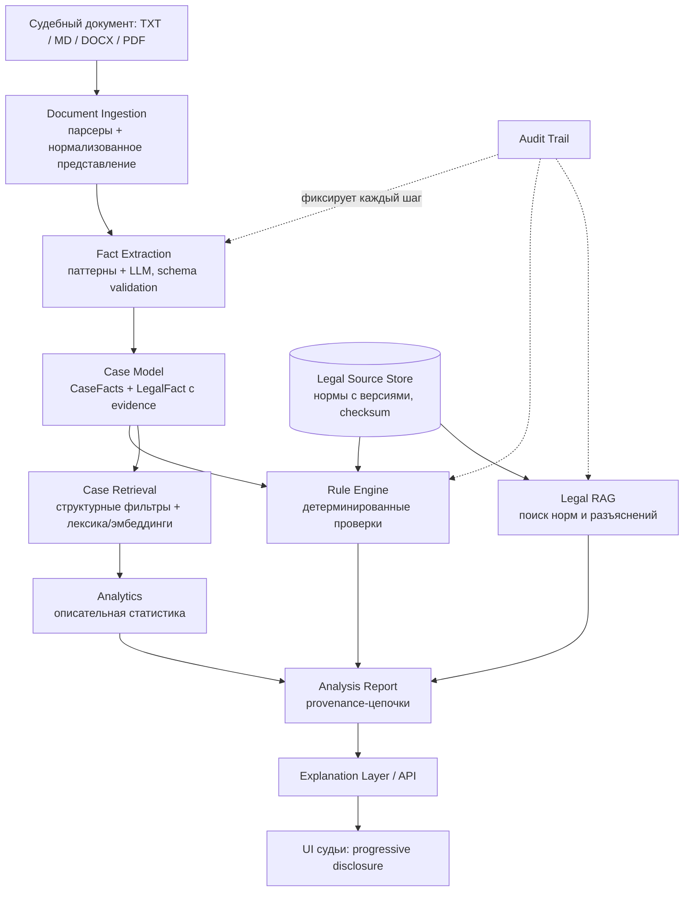

# ARCHITECTURE

Модульный монолит на Python 3.11+. Один процесс, слои разделены интерфейсами;
модули не ходят друг к другу в обход контрактов. Модульный монолит предпочтён
преждевременному делению на службы (см. «Ключевые решения»).

## Конвейер



## Слои

| Слой | Модуль | Ответственность | Запрещено |
|---|---|---|---|
| Представление | `api`, `static`, `cli` | HTTP DTO, раздача UI, консольные команды | Бизнес-логика в хендлерах |
| Оркестрация | `pipeline/` | Последовательность этапов анализа | Собственные юридические утверждения |
| Домен | `domain` | Pydantic-модели фактов, норм, оценок | I/O, сеть, файлы |
| Приложение | `fact_extraction`, `rule_engine`, `legal_sources`, `retrieval`, `analytics` | Реализация этапов | Прямые LLM-вызовы вне `llm` |
| Инфраструктура | `storage`, `llm`, `audit` | Репозитории, LLM-провайдеры, журнал | Юридическая семантика |

## Раскладка пакета

```text
src/second_opinion/
  analytics/        описательная статистика по выборке дел
  api/              HTTP: сборка приложения, роутеры по ресурсам, схемы
  audit/            журнал операций (хэши и версии, без текстов)
  auth/             учётные записи, пароли, токены, ограничитель входов
  cli/              консольные команды
  domain/           модели: факты, нормы, отчёт, пользователи
  export/           заключение в .docx
  fact_extraction/  паттерновый и модельный извлекатели
  ingestion/        парсеры TXT, Markdown, DOCX, PDF и OCR-фолбэк
  legal_rag/        поиск по базе норм с обязательным цитированием
  legal_sources/    корпус норм, редакции, опечатывание, сверка с ИПС
  llm/              интерфейс языковой модели и адаптеры
  pipeline/         AnalysisPipeline — фасад; ingestion.py и derivation.py — сотрудники
  prompts/          версионируемые промпты (часть пакета)
  retrieval/        подбор сопоставимых дел
  rule_engine/      детерминированные проверки; rules/ — по предмету
  static/           интерфейс судьи
  storage/          файловые и PostgreSQL-репозитории за протоколом

  reporting.py      изложение дела и проблемные места
  privacy.py        обнаружение и маскирование персональных данных
  fact_values.py    допустимые значения обстоятельств
  config.py         параметры развёртывания из окружения
  metrics.py        счётчики и гистограммы
  prompts.py        загрузка промптов
  logging_utils.py  запись стадий разбора

evaluation/         метрики, датасеты, отчёты
data/fixtures/      нормы и синтетические дела
tests/unit/         быстрые проверки отдельных модулей
tests/integration/  проверки через API и конвейер целиком
```

Раскладка проверяется тестом: описание выше и каталоги на диске обязаны совпадать.

## Ключевые решения

Решения, которые трудно обратить, и то, что было отклонено.

| Решение | Почему | Отклонено |
|---|---|---|
| Детерминированный движок правил, модель только извлекает факты и никогда не оценивает право | воспроизводимость, трассируемость, регрессионные тесты | модель без движка (чёрный ящик), внешний движок правил, собственный язык правил |
| Нормы хранятся по редакциям, доступ одной функцией `get_norm(norm_id, applicable_at)`, пересечение интервалов запрещено при загрузке | редакция 2026 года не должна молча применяться к делу 2022 года | хранить только текущую редакцию, граф версий в графовой базе |
| Структурные фильтры первыми, семантика поверх: сходство дел не считается процентом | «похожесть 92%» превращается в псевдоюридический вывод | только эмбеддинги, только точное совпадение признаков |
| Модель за интерфейсом `LLMProvider` (мок по умолчанию, любой OpenAI-совместимый адрес) | переносимость, тестирование без сети, закрытый контур | прямые вызовы SDK поставщика |
| Происхождение вшито в модель данных: факт без цитаты не бывает подтверждённым, правило ссылается на факты и редакции нормы | ответ на «почему система это утверждает» строится из данных, а не из текста отчёта | добавить прослеживаемость позже, ссылки свободным текстом |
| Хранилище за интерфейсами: файлы по умолчанию, PostgreSQL выбирается конфигурацией | запуск одной командой, тривиальные резервные копии; миграция доказана тестами против настоящей базы | сразу PostgreSQL, SQLite |
| Интерфейс судьи: статическая страница без сборщика, общается с тем же REST API | нет инструментов сборки в закрытом контуре, быстрые итерации | отдельный фронтенд, серверные шаблоны |
| Двухслойная авторизация: общий секрет или личный токен, оба принимаются на `/api/*` | старые клиенты не ломаются при включении личных учётных записей | строго один из двух слоёв, перенос маршрутов входа |
| Источник редакционной истории: ИПС pravo.gov.ru (государственный, без токена, консолидированные редакции) | нужна история редакций, а не только действующий текст | RusLawOD (только исходные редакции), Russian-Law-MCP (только текущий текст), ГАРАНТ как основной (нужен токен) |

## Как разложен код

Файл называется по предмету, а не по техническому слою: путь в адресной
строке и имя модуля совпадают.

```text
api/
  app.py            сборка приложения: middleware, обработчики ошибок, маршруты
  auth_mode.py      режимы авторизации (open / shared / accounts)
  errors.py         единый формат ошибки
  request_context.py  идентификатор запроса и актор
  uploads.py        чтение загружаемого файла в пределах лимита
  routers/          обработчики по ресурсам: documents, analyses, norms,
                    cases, search, service
  schemas.py        модели ответов
  auth_routes.py    вход, профиль, управление учётными записями
  deps.py           сборка конвейера, поисковика и носителей

cli/
  __init__.py       разбор аргументов и таблица команд
  bind.py           проверка связки «адрес привязки ↔ авторизация»
  serve.py          запуск приложения, первый администратор
  documents.py      разбор файла, обезличивание, метрики
  norms.py          корпус норм: покрытие, импорт, опечатывание, редакции
  redactions.py     сверка с ИПС pravo.gov.ru

rule_engine/rules/  правила по предмету: sanction, stage, procedure,
                    mitigating, sentence, base

pipeline/           AnalysisPipeline — фасад с публичным интерфейсом
                    конвейера (ingest, analyze, update_fact, add_fact,
                    history, delete_*); ingestion.py и derivation.py —
                    сотрудники, которым он делегирует загрузку документа
                    и пересчёт факты -> проверки -> практика -> аналитика

верхний уровень пакета — то, что не принадлежит ни одному этапу:
  reporting.py      изложение дела и проблемные места из готового отчёта
  privacy.py        обнаружение и маскирование персональных данных
  fact_values.py    допустимые значения обстоятельств (правило домена)
  config.py         параметры развёртывания из окружения
  metrics.py        счётчики и гистограммы
  prompts.py        загрузка промптов из пакета
  logging_utils.py  запись стадий разбора в журнал
```

Канонический путь API — `/api/v1/...`; те же маршруты подключены вторым
разом под прежним `/api/...` и скрыты из спецификации (см. `app.py`).

## Компоненты

### Document ingestion (`ingestion/`)
Парсеры TXT, Markdown, DOCX, PDF (текстовый слой) -> нормализованный
`Document`: `Section`/фрагменты с `start_offset`/`end_offset` (и `page` для
PDF). Все последующие ссылки на текст документа идут только через оффсеты.

### Fact extraction (`fact_extraction/`)
Два экстрактора за общим интерфейсом:
- **паттерновый** (детерминированный): квалификации «ч. 2 ст. 158 УК РФ»,
  возраст, смягчающие/отягчающие маркеры, вид/размер наказания, особый
  порядок. Каждый результат несёт evidence с оффсетами совпадения.
- **LLM-экстрактор**: структурированный вывод по схеме (повторная попытка при
  невалидном JSON), валидация Pydantic-схемой.

Результаты объединяются; факт без evidence не может получить статус
`VERIFIED`. Объединение асимметрично: факты модели получают статус `LIKELY`,
проходят ту же проверку значения, что и введённые человеком
(`validate_fact_value`), и для скалярных типов (возраст, стадия, признание
вины, особый порядок, присяжные, вид и срок наказания, условность, дата
деяния, судимость) только заполняют то, что паттерны не нашли. Запись модели
с пустой цитатой отбрасывается отдельно, не отменяя остальной ответ.

### Legal ontology / Case model (`domain/`)
Разделены: факт (`LegalFact`), обстоятельство, норма (`LegalNorm`), версия
нормы (`NormVersion`), применение (`RuleEvaluation`), вывод, источник,
судебный акт (`ComparableCase`). Подробности — `DOMAIN_MODEL.md`.

### Temporal legal source storage (`legal_sources/`)
`NormStore.get_norm(norm_id, applicable_at)` возвращает редакцию, действовавшую
на дату. Каждая редакция: `effective_from/to`, источник, `retrieved_at`,
SHA-256 контрольная сумма текста.

### Rule engine (`rule_engine/`) Принимает `CaseFacts` + применимые редакции
норм; выдаёт `RuleEvaluation[]` со статусами `PASS / WARNING / FAIL / UNKNOWN /
NOT_APPLICABLE`, списками использованных фактов и норм, объяснением и
provenance. Правила — версионируемые Python-классы с декларативными метаданными
(без самописного DSL).

### Legal RAG (`legal_rag/`)
Поиск норм и разъяснений: токенизация запроса (стоп-слова, префиксный учёт
словоформ) -> фильтры метаданных (`код`, `статья`) -> выбор редакции
(`applicable_at`) -> IDF-ранжирование по корпусу редакций. Каждый результат
несёт фрагмент реального источника с редакцией, периодом действия,
источником и SHA-256; пустой результат не подменяется генерацией.
Гибридный режим (лексика + векторная близость, слияние рангов) реализован
и включается `SO_RAG_MODE`; по умолчанию лексический: на корпусе такого
размера он точнее, это измерено. Поиск по базе закрыт `NormStore` +
`/api/v1/search`; полные тексты Пленумов и обзоров — наполнение данных.

### Case retrieval (`retrieval/`)
Поиск сопоставимых дел: структурные фильтры (статья, часть, покушение,
рецидив, процедура) -> ранжирование с объяснением отбора. Сходство —
справочный сигнал, не основание для вывода о наказании.

### Analytics (`analytics/`)
Описательная статистика по выборке: N, медиана/перцентили, распределение
видов наказания, доля условного. Только дескриптивные формулировки.

### Audit trail (`audit/`)
JSONL-журнал: время, операция, компонент, хэши входа/выхода, модель и её
версия, версия промпта, версия правил, версии норм. Позволяет воспроизвести
любой отчёт.

### LLM (`llm/`)
Интерфейс `LLMProvider` (`generate_structured`, `generate_text`, `embed`),
адаптеры: `MockLLMProvider` (тесты/офлайн), `OpenAICompatibleProvider`
(любой OpenAI-совместимый контур). Ключи — только из переменных окружения.

### Evaluation (`evaluation/`)
Метрики: precision/recall/F1 извлечения + корректность и покрытие evidence;
Recall@K/MRR/nDCG поиска; полнота цитирования; корректность выбора редакции;
регрессия Rule Engine; `unsupported_claim_rate` (целевое -> 0).

### Auth (`auth/`, `api/auth_routes.py`)
`AuthService` (bcrypt, JWT access/refresh, in-memory `dict[str, User]`,
`AuthUser`/`TokenPayload`/`TokenPair` модели), RBAC через `require_role`.
Эндпоинты `/auth/{login,refresh,me,logout,users,audit}`; записи и пароли меняются командами оператора (`cli/serve.py`).
MVP без БД; миграция на PostgreSQL выполнена (нужны refresh-токены
с ротацией, blacklist, истечение паролей).

### Metrics (`metrics.py`)
Внутренний `MetricsRegistry` (потокобезопасные счётчики и гистограммы;
включается `SO_METRICS_ENABLED=1`). Снимок — `/metrics` endpoint.
Метрики: `analyses_total`, `analyses_failed_total`, длительности
`extract/analyze/retrieval/rule_engine_duration_seconds`, per-rule
`rule_evaluations`. Без внешних зависимостей (без prometheus_client);
прометей-совместимая модель данных.

## Технологический стек MVP

- Python 3.11+, FastAPI, Pydantic v2, uvicorn.
- Хранение: файловые репозитории (по умолчанию) или PostgreSQL
  (`SO_STORAGE_BACKEND=postgres` + `SO_DATABASE_URL`, JSONB); pgvector
  для семантики (`PgVectorNormStore`, `vector(1024)`, HNSW cosine,
  `SO_RAG_MODE=hybrid_pgvector`).
- Аутентификация: общий секрет `SO_AUTH_TOKEN` и личные учётные записи (JWT,
  роли `judge`/`clerk`/`admin`, хранятся в файлах или PostgreSQL); оба слоя принимаются на `/api/*`, режимы описаны в `docs/SECURITY.md`.
- Тесты: pytest; линт: ruff; CI: GitHub Actions (lint + tests + eval +
  pip-audit блокирующий).

## Развёртывание

Одна команда: `make dev` (или `.venv\Scripts\second-opinion serve`).
Docker Compose (`docker compose up` / `--profile postgres up`) с
healthcheck и публикацией только на loopback; для языковой модели в
закрытом контуре — профили `vllm` (GPU) и `vllm-cpu` (проверка контракта
без GPU). Подробности — [README.md](../README.md).
