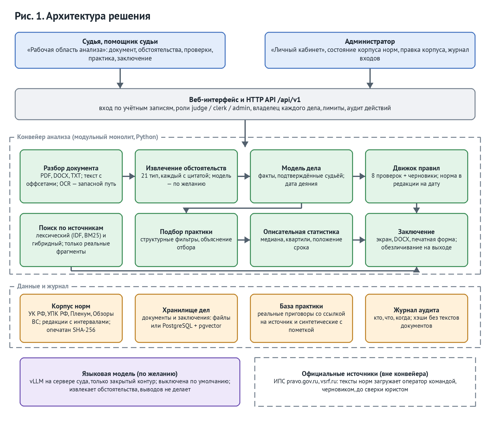
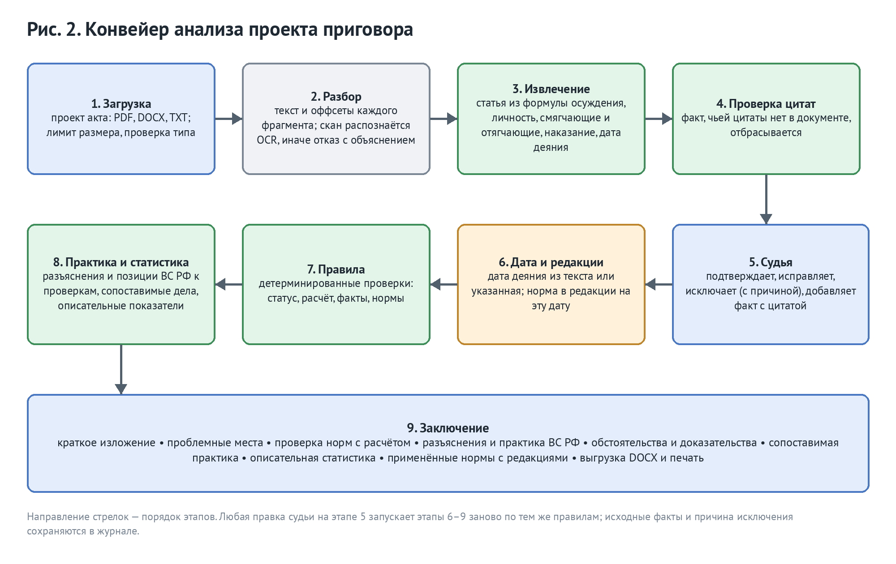
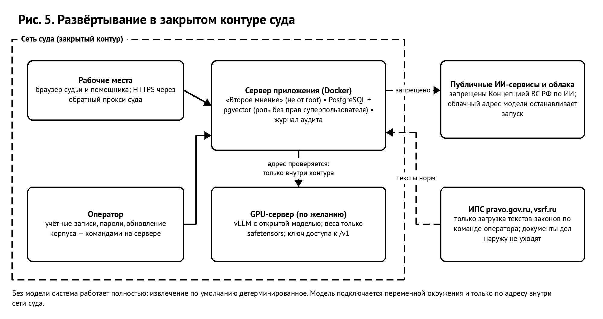

# Архитектура

Модульный монолит на Python 3.11+: один процесс, слои разделены интерфейсами, модули обращаются друг к другу только через контракты. Для системы такого объёма деление на отдельные службы добавило бы точек отказа без выигрыша в надёжности.

Требование п. 2.2 Положения о конкурсе («описание архитектуры решения») закрывает этот документ вместе с концепцией (`docs/CONCEPT.md`, раздел 3); схемы общие: `docs/concept/*.png`.



## Конвейер анализа



| Этап | Модуль | Что делает |
|---|---|---|
| Загрузка и разбор | `ingestion/` | читает TXT, Markdown, DOCX, PDF; скан без текстового слоя распознаёт OCR; хранит текст со смещениями |
| Извлечение | `fact_extraction/` | находит 21 тип обстоятельств, у каждого цитата со смещениями; модель в закрытом контуре дополняет правила разбора |
| Модель дела | `fact_extraction/builder.py` | собирает `CaseFacts` из подтверждённых фактов |
| Редакции | `legal_sources/` | отдаёт норму в редакции на дату деяния |
| Проверки | `rule_engine/` | детерминированные правила: статус, расчёт, факты, нормы |
| Практика | `retrieval/`, `analytics/` | сопоставимые дела и описательная статистика |
| Разъяснения | `pipeline/derivation.py` | позиции Пленума и Обзоров ВС РФ к выполненным проверкам |
| Заключение | `reporting.py`, `export/` | изложение, проблемные места, DOCX и печатная форма |

Правка обстоятельства судьёй запускает этапы с «Модели дела» заново по тем же правилам.

## Слои

| Слой | Модули | Отвечает за | Запрещено |
|---|---|---|---|
| Представление | `api`, `static`, `cli` | HTTP, интерфейс судьи, консольные команды | бизнес-логика в обработчиках |
| Оркестрация | `pipeline` | порядок этапов анализа | собственные юридические утверждения |
| Домен | `domain` | модели фактов, норм, проверок, отчёта | обращения к сети и файлам |
| Приложение | `fact_extraction`, `rule_engine`, `legal_sources`, `legal_rag`, `retrieval`, `analytics`, `export` | этапы анализа | вызовы модели в обход `llm` |
| Инфраструктура | `storage`, `llm`, `audit`, `auth` | хранилища, провайдер модели, журнал, учётные записи | юридическая семантика |

## Раскладка пакета

```text
src/second_opinion/
  analytics/        описательная статистика по выборке дел
  api/              HTTP: сборка приложения, маршруты по ресурсам, схемы ответов
  audit/            журнал операций: кто, что, когда; хэши без текстов
  auth/             учётные записи, пароли, токены, ограничение частоты входа
  cli/              консольные команды оператора
  domain/           модели: факты, нормы, санкции, отчёт, пользователи
  export/           лист заключения, DOCX и печатная форма
  fact_extraction/  правила разбора, модельный извлекатель, сборка дела
  ingestion/        разбор TXT, Markdown, DOCX, PDF и OCR
  legal_rag/        поиск по корпусу норм с цитированием
  legal_sources/    корпус норм, редакции, опечатывание, ИПС, разбор санкций
  llm/              интерфейс модели, адаптер закрытого контура, проверка адреса
  pipeline/         фасад конвейера, загрузка документа, вывод из фактов
  prompts/          версионируемые промпты извлечения
  retrieval/        подбор сопоставимых дел
  rule_engine/      детерминированные проверки; rules/ — по предмету
  static/           интерфейс судьи
  storage/          файловые и PostgreSQL-хранилища за общим протоколом

  reporting.py      изложение дела и проблемные места
  privacy.py        обнаружение и маскирование персональных данных
  fact_values.py    допустимые значения обстоятельств
  config.py         параметры развёртывания из окружения
  metrics.py        счётчики и гистограммы
  prompts.py        загрузка промптов
  logging_utils.py  запись стадий разбора

evaluation/         метрики, наборы данных, отчёты оценки
data/fixtures/      корпус норм, дела практики, образцы документов
docs/concept/       схемы концепции и этого документа
scripts/            загрузка норм из ИПС и vsrf.ru, сборка концепции
tests/unit/         проверки отдельных модулей
tests/integration/  проверки через API и конвейер целиком
```

Тест `test_repository_layout` сверяет этот блок с каталогами на диске.

## Компоненты

### Разбор документа (`ingestion/`)

Каждый формат приводится к `Document`: текст, SHA-256, смещения фрагментов, для PDF номер страницы. Все ссылки на документ дальше идут только через смещения. Тип файла сверяется с содержимым; размер ограничен до разбора.

### Извлечение обстоятельств (`fact_extraction/`)

Текст делится на вводную, описательно-мотивировочную («У С Т А Н О В И Л») и резолютивную («П Р И Г О В О Р И Л») части. Квалификация берётся из формулы осуждения в резолютивной части; статьи Общей части (ст. 1–104) квалификацией не считаются. Наказание извлекается по видам: срок в месяцах, обязательные работы в часах, основной штраф в рублях, окончательный срок по совокупности. Отрицание («отягчающих обстоятельств не установлено») и сведения о других лицах фактов не создают.

Модельный извлекатель (`llm_extractor.py`, промпт `v3`) включается настройкой. Его факты получают статус «вероятен», проходят ту же проверку значения, что и введённые человеком (`fact_values.py`), и не участвуют в проверках, пока судья их не подтвердил. Факт, чьей цитаты нет в тексте, отбрасывается; подтверждённый факт без цитаты существовать не может.

### Корпус норм (`legal_sources/`)

`NormStore.get_norm(norm_id, applicable_at)` возвращает редакцию, чей интервал содержит дату; пересечение интервалов запрещено при загрузке. Редакция хранит текст, интервал, источник, дату выгрузки, SHA-256 и статус сверки. Санкция (`SanctionSpec`) хранит пределы по виду наказания: месяцы, часы или рубли; у записи может быть свой интервал внутри редакции и пометка «не сверено юристом». Корпус опечатан манифестом (`sealing.py`), CI отклоняет правку без переопечатывания.

Источник редакций — ИПС «Законодательство России» (`pravo_gov.py`): список редакций, тексты статей, поиск изменений делением пополам (`history_trace.py`). `sanction_text.py` разбирает санкцию части статьи на основные наказания и пределы. Постановления Пленума и Обзоры загружаются из официальных PDF на vsrf.ru (`scripts/fetch_vsrf_document.py`). Поле `applies_to` у разъяснения связывает его с проверками.

### Проверки (`rule_engine/`)

Правило — версионируемый класс с нормой-основанием. Получает `CaseFacts`, хранилище и дату, возвращает `RuleEvaluation`: статус `PASS / WARNING / FAIL / UNKNOWN / NOT_APPLICABLE`, объяснение, числа расчёта, использованные факты и нормы с идентификатором редакции. Не хватает данных — `UNKNOWN` с перечнем недостающего. Реестр — `DEFAULT_RULES`; черновики (`rules/release.py`, `combination.py`, `limitation.py`) в реестр не входят, пока юрист не сверит нормы-основания. Перечень правил — `docs/RULE_ENGINE.md`.

### Поиск по источникам (`legal_rag/`)

Лексический режим: токенизация с отбрасыванием служебных слов, «ё» читается как «е», вес по редкости термина (IDF), точное совпадение и совпадение основы, поправка на длину текста по BM25 (k1 = 1,2, b = 0,75), черновик весит 0,85 от сверенного источника. Гибридный режим добавляет векторную близость (символьные n-граммы с хэшированием или pgvector) и складывает нормированные оценки с весами 0,7 и 0,3. Результат — только фрагменты хранящихся редакций с реквизитами.

### Практика и статистика (`retrieval/`, `analytics/`)

Подбор: статья — обязательный фильтр, часть, стадия, процедура, рецидив и смягчающие дают причины отбора. Сходство процентом не выражается. Статистика: медиана, квартили, распределение видов наказания, доля условного осуждения, положение назначенного срока в выборке.

### Заключение (`reporting.py`, `export/`)

`report_sheet.py` собирает лист заключения из отчёта: дело и документ, краткое изложение, проблемные места, проверка норм, разъяснения и практика ВС РФ, обстоятельства и доказательства, сопоставимая практика, статистика, применённые нормы. Из одного листа строятся DOCX (`docx_report.py`) и печатная форма (`html_report.py`).

### Модель (`llm/`)

Интерфейс `LLMProvider`; реализации — `MockLLMProvider` (по умолчанию, офлайн) и `OpenAICompatibleProvider` для модели в сети суда (vLLM, Ollama). `contour.py` при сборке конвейера пропускает только адреса закрытого контура: localhost, частные адреса, имя сервиса Docker, зоны `.local`, `.internal`, `.lan` и серверы из `SO_LLM_CONTOUR_HOSTS`.

### Учётные записи и журнал (`auth/`, `audit/`)

Роли `judge`, `clerk`, `admin`; пароли bcrypt; JWT доступа на 30 минут и токен обновления в cookie `HttpOnly`. Записи хранятся в файлах или PostgreSQL; заводит и меняет их оператор командами `create-user`, `update-user`, `delete-user`, `reset-password`. Журнал аудита — JSONL с операцией, исполнителем, хэшами входа и выхода, версиями правил, промпта и норм.

### Метрики (`metrics.py`)

Счётчики и гистограммы без внешних зависимостей, включаются `SO_METRICS_ENABLED=1`, снимок — `/metrics`: число анализов и ошибок, длительность этапов, ответы по статусам.

## Ключевые решения

| Решение | Причина | Отклонено |
|---|---|---|
| Юридические выводы делает детерминированный движок; модель только извлекает обстоятельства | вывод воспроизводим и раскрывается до нормы | модель без движка, внешний движок правил, собственный язык правил |
| Норма хранится по редакциям, запрос принимает дату | редакция 2026 года не применяется к делу 2022 года | только текущая редакция, графовая база версий |
| Происхождение в модели данных: подтверждённый факт обязан иметь цитату, проверка ссылается на факты и редакции | заключение раскрывается из данных, а не из текста | ссылки свободным текстом |
| Сначала структурные фильтры, потом семантика; сходство без процентов | процент сходства выглядит как юридический вывод | только векторная близость |
| Модель за интерфейсом провайдера, только в закрытом контуре | Концепция ВС РФ по ИИ запрещает публичные облака | облачные адаптеры |
| Хранилища за интерфейсом: файлы по умолчанию, PostgreSQL настройкой | запуск одной командой и эксплуатация на базе | только PostgreSQL, SQLite |
| Интерфейс — статическая страница без сборщика поверх того же REST API | в закрытом контуре нет инструментов сборки | отдельный фронтенд, серверные шаблоны |
| Редакции из ИПС pravo.gov.ru | государственный источник с консолидированными редакциями, без токена | RusLawOD (только исходные редакции), Russian-Law-MCP (только текущий текст), ГАРАНТ основным (нужен токен) |

## Технологии

- Python 3.11+, FastAPI, Pydantic v2, uvicorn.
- Хранение: файлы или PostgreSQL 16 (JSONB) с pgvector (`vector(1024)`, HNSW) для гибридного поиска.
- Документы: python-docx, pypdf, Tesseract OCR; заключение — python-docx; схемы концепции — Pillow, PDF концепции — reportlab.
- Проверки качества: pytest, ruff, mypy, pip-audit; CI на GitHub Actions.

## Развёртывание

`make dev` запускает приложение локально. `docker compose up` — приложение в контейнере, `--profile postgres` добавляет базу, профили `vllm` (GPU) и `vllm-cpu` — модель в закрытом контуре. Порты публикуются только на loopback, приложение работает не от root. Пошагово — `README.md` и `docs/DEPLOYMENT_VLLM.md`.


