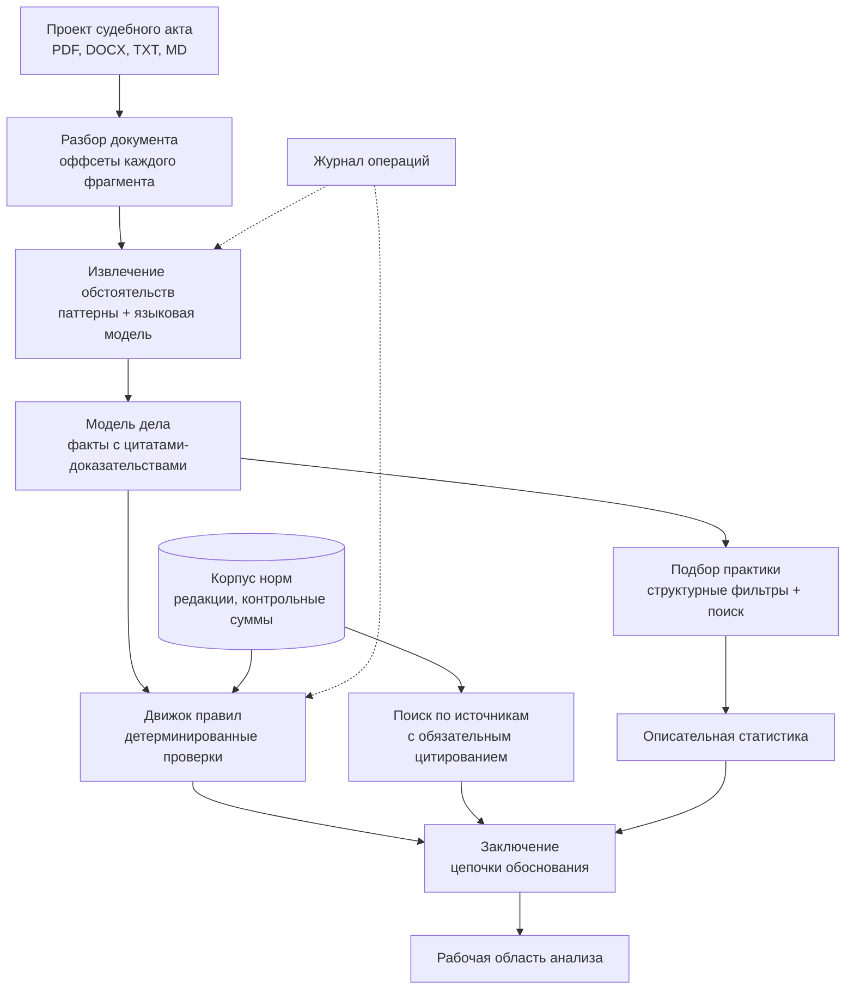

# Концепция проекта «Второе мнение»

Конкурсная работа на отборочный этап Всероссийского конкурса студенческих
проектов «Алгоритм правосудия. Второе мнение» (Положение утверждено
приказом Председателя Верховного Суда РФ от 31.07.2026 № 55-П).

Документ отвечает на требование п. 2.2 Положения: описание архитектуры
решения, используемых данных, алгоритмов и правовой методологии.

Состояние на 20.09.2026: работающий прототип, 593 автоматические проверки,
27 норм с редакциями, 8 детерминированных правил. Что сделано и что нет —
раздел «Честная карта покрытия».

## Содержание

- [Задача и подход](#задача-и-подход)
- [Правовая методология](#правовая-методология)
- [Архитектура решения](#архитектура-решения)
- [Используемые данные](#используемые-данные)
- [Алгоритмы](#алгоритмы)
- [Соответствие требованиям Положения](#соответствие-требованиям-положения)
- [Честная карта покрытия](#честная-карта-покрытия)
- [План до финала](#план-до-финала)

## Задача и подход

Судья готовит проект приговора. Система принимает этот проект и отвечает
на один вопрос: **не разошёлся ли он с законом и практикой** — и, если
разошёлся, показывает, где именно и на каком основании.

Ключевой выбор проекта: **проверяемость важнее полноты**. Система не
отвечает на вопрос «какое наказание правильное» — она отвечает «вот
проверки, которые я умею провести, вот их результат, вот источник
каждого». То, что проверить нельзя, называется прямо, а не сглаживается.

Отсюда главное свойство: **каждое утверждение раскрывается до источника**.

```text
вывод → юридический факт → цитата из документа с оффсетами
      → правило → редакция нормы на дату деяния → официальный источник
```

Цепочка не декларация, а инвариант, закреплённый в коде и тестах: факт без
цитаты не может получить статус «подтверждён», правило без нормы-основания
не регистрируется, норма без сверки юристом остаётся черновиком.

## Правовая методология

### Норма применяется в редакции на момент совершения преступления

Требование п. 2.5.1.в. Реализовано как свойство хранилища, а не как
проверка на выходе: `get_norm(norm_id, applicable_at)` физически не умеет
вернуть «текущую» редакцию для исторического дела. Каждая редакция несёт
интервал действия, источник, дату выгрузки и контрольную сумму текста.

Дата юридически значимого события извлекается из документа; если её нет,
система говорит об этом, а не подставляет сегодняшнюю.

Свежая редакция никогда не подставляется молча. Плановая сверка с
официальным источником обнаруживает изменение нормы и **зовёт человека**,
а не обновляет корпус сама.

### Правило — это код с нормой-основанием, а не эвристика

Каждое правило — версионируемый класс, который обязан перечислить
использованные факты и применённые нормы с номером редакции, привести
численный расчёт и объяснение. Правило, не сумевшее этого, возвращает
«данных недостаточно», а не догадку.

Восемь правил закрывают пределы назначения наказания: санкция статьи,
неоконченное преступление (ст. 66), особый порядок (ч. 5 ст. 62,
ч. 7 ст. 316 УПК), смягчающие пп. «и»/«к» (ч. 1 ст. 62), комбинированный
предел, условное осуждение (ст. 73), несовершеннолетние (ст. 420 УПК),
полнота данных о наказании.

Два правила были **удалены** после юридической сверки: они кодировали
неверно понятые нормы. Это записано в истории проекта и считается
нормальной частью методологии, а не провалом.

### Основания освобождения от ответственности и наказания

Требование п. 2.5 Положения. Охватывается весь раздел IV УК РФ (ст. 75–86):
главы 11 и 12 — освобождение от уголовной ответственности и от наказания,
глава 13 — амнистия, помилование, судимость.

Проверка отвечает на вопрос «не упущено ли основание»: категория
преступления, совершено ли впервые, возмещён ли ущерб, состоялось ли
примирение, не истекли ли сроки давности — всё это система извлекает из
документа и сопоставляет с условиями статей.

Два ограничения заложены в устройство, а не в оговорку:

1. Результат — **только предупреждение или «данных недостаточно»**.
   Формулировка «проверьте, не применима ли ст. 76.2», а не «прекратите
   дело». Решение о прекращении — исключительно судейское (п. 2.5.3).
2. Правило **знает свою процессуальную стадию**. Условно-досрочное
   освобождение и замена неотбытой части относятся к исполнению приговора;
   указание на них в проекте приговора было бы ошибкой, а не полнотой.

### Статистика описательна и не является основанием

Сопоставимая практика и распределение сроков — справочный материал.
Система показывает, где назначенный срок стоит в распределении, и
сопровождает это оговоркой. Формулировки проверяются автоматически: слова
«следует», «рекомендуется», «завышен», «занижен» в описательных выводах
недопустимы и ломают сборку.

Сходство между делами не выражается процентом: процент создаёт видимость
измеренной близости там, где её нет.

### Чего система не делает никогда

- не выдумывает источники: пустой результат поиска остаётся пустым;
- не выдаёт вывод языковой модели за юридическое основание;
- не прячет неопределённость;
- не добавляет правило без верифицированной нормы-основания;
- не отправляет документы во внешний контур без явного решения оператора.

## Архитектура решения

Модульный монолит на Python 3.11+ (FastAPI, Pydantic v2). Выбор против
микросервисов сделан осознанно и зафиксирован решением: на этом объёме
деление на службы добавляет отказы, а не надёжность.



Слои разделены интерфейсами и не ходят друг к другу в обход контрактов:

| Слой | Ответственность | Что запрещено |
|---|---|---|
| Представление | HTTP, интерфейс судьи, консольные команды | бизнес-логика в обработчиках |
| Оркестрация | последовательность этапов разбора | собственные юридические утверждения |
| Домен | модели фактов, норм, оценок | обращения к сети и файлам |
| Приложение | извлечение, правила, источники, практика | прямые вызовы модели вне интерфейса провайдера |
| Инфраструктура | хранилища, провайдеры моделей, журнал | юридическая семантика |

Языковая модель подключена **за интерфейсом провайдера**: бизнес-логика
зависит от контракта, а не от поставщика. По умолчанию система работает
офлайн на детерминированном заменителе — внешние обращения выключены,
пока оператор не включит их сознательно.

Хранилище документов и отчётов тоже за интерфейсом: файловый носитель для
демонстрации, PostgreSQL с pgvector для эксплуатации. Переключение — одной
переменной окружения, без правки кода.

## Используемые данные

### Нормативный корпус

27 норм, 34 редакции. Каждая редакция хранит: текст, интервал действия,
источник и его реквизиты, дату выгрузки, SHA-256 текста и статус сверки.

**Статус сверки ставит юрист, а не машина.** Машинно полученный текст
остаётся черновиком. Сейчас 32 редакции сверены юристом по
КонсультантПлюс (03.09.2026), 2 — синтетическая демонстрационная норма,
явно помеченная.

Корпус **опечатан манифестом**: контрольные суммы всех редакций собраны в
отдельный файл, и подмена текста или санкции обнаруживается отдельной
командой. Правка фикстуры без переопечатывания не проходит в основную
ветку — это автоматическая проверка, а не договорённость.

Источник редакций — ИПС «Законодательство России» (`pravo.gov.ru`):
государственный, не требует токена и подписки, отдаёт консолидированные
редакции с датами. Выбор зафиксирован отдельным решением; открытые
корпуса и коммерческие системы рассмотрены и отклонены с указанием
причин.

### Судебная практика

26 синтетических дел, каждое **явно помечено** признаком синтетичности и
не выдаётся за реальную практику. Это осознанное ограничение отборочного
этапа: реальные приговоры доступны по 262-ФЗ, их подключение — работа к
финалу, требующая решения об источнике и обезличивания.

### Персональные данные

Обезличивание делается **на выходе, а не при загрузке**: хранится
дословный текст, иначе невозможно выполнить инвариант о цитате.
Маскирование перед передачей внешней модели включено по умолчанию и
**сохраняет длину фрагментов** — иначе оффсеты сдвигаются и цитаты
отсеиваются как выдуманные.

Полнота обезличивания не гарантируется, и это сказано в интерфейсе, в
документации и в коде. Реализовано право на забвение: удаление документа
каскадом удаляет отчёты по нему.

## Алгоритмы

### Извлечение обстоятельств — два независимых пути

**Паттерновый извлекатель** (детерминированный): квалификация вида
«ч. 2 ст. 158 УК РФ», возраст, маркеры смягчающих и отягчающих, вид и
размер наказания, особый порядок, стадия преступления, дата деяния.
17 типов обстоятельств. Каждый результат несёт цитату с оффсетами
совпадения.

**Извлечение языковой моделью**: структурированный вывод по схеме с
повторной попыткой при негодном ответе и валидацией. Текст документа
передаётся модели **как данные** между явными метками, системные
инструкции отделены — защита от инъекций в тексте документа проверяется
тестом.

Результаты объединяются; **цитата каждого факта проверяется по исходному
тексту**, и факт, чью цитату в документе не нашли, отбрасывается. Это
делает выдумывание фактов моделью технически безрезультатным.

Качество измеряется: macro-F1 извлечения 0.982, доля утверждений без
доказательства — 0.

### Выбор редакции нормы

Бинарный поиск по интервалам действия с проверкой границ. Точность выбора
редакции на дату — 1.0 на контрольном наборе, включая краевые случаи
(день вступления редакции в силу, день окончания её действия).

### Поиск по источникам

Лексический поиск с учётом словоформ и взвешиванием по редкости термина
(IDF) по корпусу редакций. Каждый результат — фрагмент реально хранящейся
редакции с реквизитами; пустой результат не подменяется генерацией.
Recall@5 = 1.0 на контрольном наборе из 18 запросов.

Гибридный режим (лексика + векторная близость на pgvector) реализован и
включается переключателем. Векторная часть на отборочном этапе не
является основной: на корпусе такого размера лексический поиск точнее, и
это измерено, а не предположено.

### Подбор сопоставимых дел

Структурные фильтры по статье, части, стадии, рецидиву и процедуре, затем
ранжирование. Отбор объясняется: видно, по каким признакам дело признано
сопоставимым.

### Описательная статистика

Медиана, квартили, распределение видов наказания, доля условного
осуждения, положение назначенного срока в выборке. Выход срока за весь
наблюдаемый диапазон попадает в раздел проблемных мест; попадание в
верхнюю четверть — нет, это обычное дело.

## Соответствие требованиям Положения

| Пункт | Требование | Состояние |
|---|---|---|
| 2.5.1.а | Загрузка акта в машиночитаемом виде | ✅ PDF, DOCX, TXT, Markdown; распознавание сканов как запасной путь |
| 2.5.1.б | Извлечение ключевых параметров | ✅ 17 типов обстоятельств, каждое с цитатой |
| 2.5.1.в | Проверка по санкции, Общей части, редакции на момент деяния, Пленуму, Президиуму | ⚠️ санкция, Общая часть, редакции, Пленум — есть; Президиум — нет |
| 2.5.1.г | Поиск аналогичных приговоров, статистические отклонения | ⚠️ логика есть, практика синтетическая |
| 2.5.1.д | Заключение: аннотация, соответствие закону и практике, проблемные места, статсправка | ⚠️ всё есть, кроме Обзоров судебной практики |
| 2.5 | Основания освобождения по разделу IV УК РФ | ❌ спроектировано, в реализации |
| 2.5.2.а | «Личный кабинет» и «Рабочая область анализа» | ✅ |
| 2.5.2.б | Приоритет отечественного и открытого ПО | ⚠️ стек открытый; прогон на отечественной модели в работе |
| 2.5.2.в | Русский язык интерфейса и документации | ✅ |
| 2.5.3 | Не заменяет судью | ✅ инвариант, проверяется тестами |

## Честная карта покрытия

Раздел открыт намеренно: неназванная слабость опаснее названной, и жюри
всё равно её найдёт.

**Данные.** Практика синтетическая. 15 норм из 27 имеют одну редакцию на
длинный интервал — история изменений не зафиксирована, и обещание
«редакция на дату» держится настолько, насколько полны данные. Точки
отсчёта для сверки с официальным источником не проставлены ни у одной
нормы, поэтому плановая проверка обновлений пока работает вхолостую.

**Право.** Нет раздела IV УК РФ (в работе), правил совокупности
(ст. 69, 70), решений Президиума и Обзоров судебной практики. Отдельной
проверки по ст. 64 нет — она упоминается как возможное основание внутри
проверки пределов.

**Модель.** Извлечение языковой моделью реализовано за интерфейсом, но на
живых документах не прогонялось: все измерения получены на
детерминированном заменителе.

## План до финала

| Очередь | Работы | Почему в этом порядке |
|---|---|---|
| 1 | Раздел IV УК РФ: корпус, обстоятельства, правила | Прямое требование п. 2.5, крупнейший правовой пробел |
| 2 | Редакционная история 15 норм и точки отсчёта | «Глубина проработки нормативной базы» держится на данных |
| 3 | Совокупность (ст. 69, 70), Президиум, Обзоры | Частые практические случаи и прямые требования п. 2.5.1 |
| 4 | Реальная практика вместо синтетической | Требует решения об источнике и обезличивания |
| 5 | Живой прогон отечественной модели | Закрывает и критерий ML, и приоритет отечественных решений |

Порядок задан приоритетами проекта: юридическая корректность →
проверяемость → воспроизводимость → надёжность → удобство → скорость →
сложность машинного обучения. Он не менялся с начала работы и не будет
изменён ради баллов: система, показывающая красивую метрику на неверной
норме, вредна.

---

Подробности: [ARCHITECTURE.md](ARCHITECTURE.md) — устройство,
[TZ.md](TZ.md) — требования с номерами и статусами,
[RULE_ENGINE.md](RULE_ENGINE.md) — реестр правил,
[DATA_SOURCES.md](DATA_SOURCES.md) — источники,
[EVALUATION.md](EVALUATION.md) — методика измерений,
[LEGAL_SAFETY_PRINCIPLES.md](LEGAL_SAFETY_PRINCIPLES.md) — принципы
безопасного обращения с правом.
