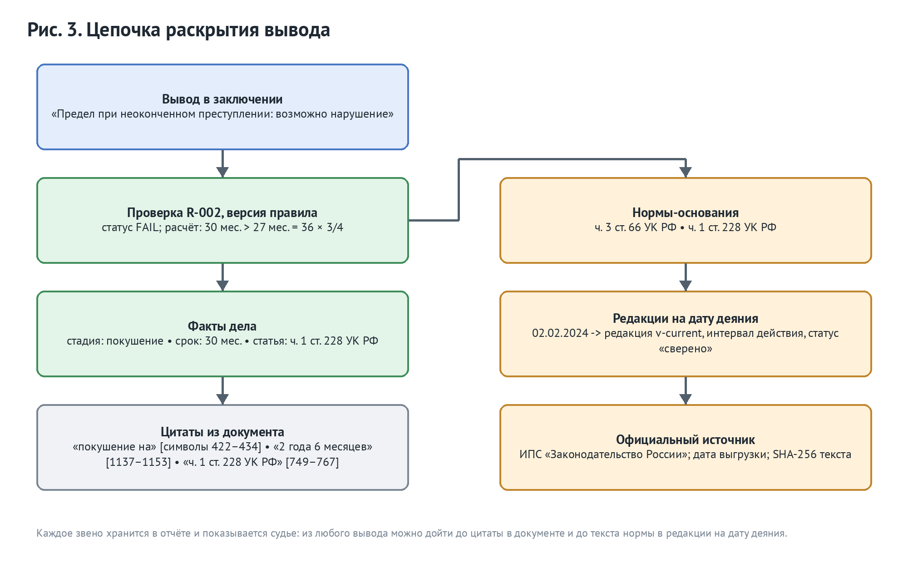
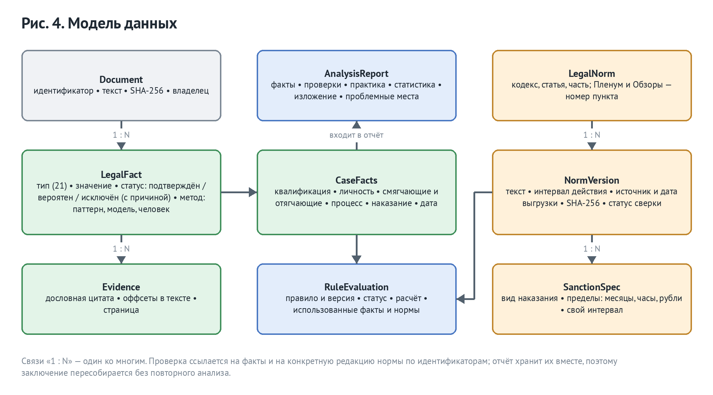
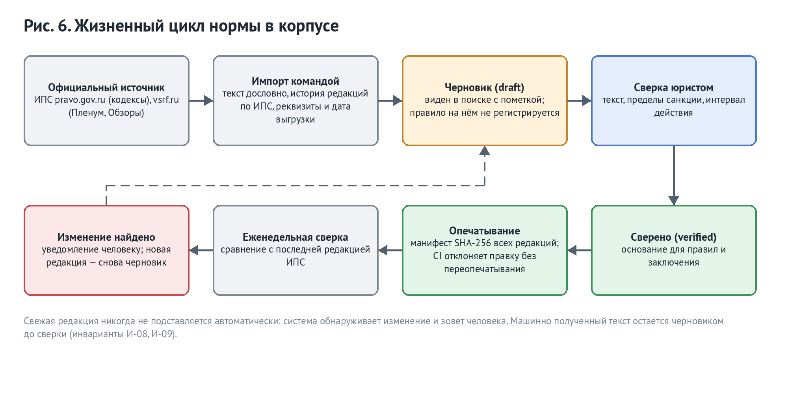
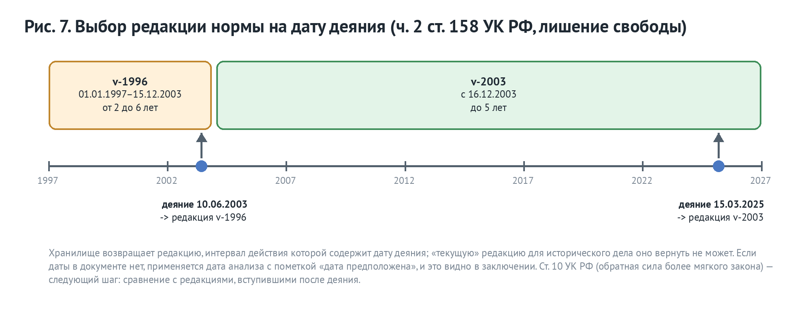
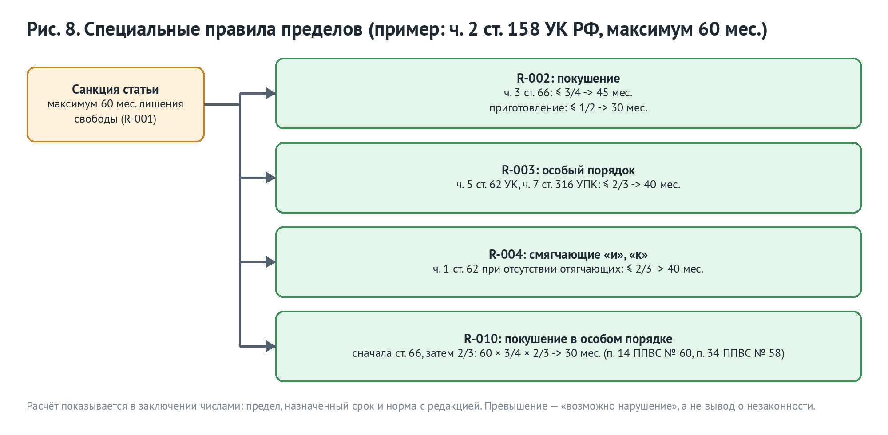

# Концепция проекта «Второе мнение»

**Система проверки проекта приговора в части назначения наказания: соответствие закону в редакции на дату деяния, судебной практике и разъяснениям Верховного Суда, с раскрытием каждого вывода до цитаты и нормы.**

Конкурсная работа отборочного этапа Всероссийского конкурса студенческих проектов «Алгоритм правосудия. Второе мнение» (Положение утверждено приказом Председателя Верховного Суда РФ от 31.07.2026 № 55-П). По п. 2.2 Положения концепция включает описание архитектуры решения, используемых данных, алгоритмов и правовой методологии; им соответствуют разделы 3–6 в том же порядке.

Состояние на 10.10.2026: работающий прототип (Python, 111 модулей, около 14,6 тыс. строк), 1000 автоматических тестов, корпус из 67 норм и разъяснений в 74 редакциях, 8 действующих детерминированных проверок и 3 черновика, веб-интерфейс с «Личным кабинетом» и «Рабочей областью анализа», выгрузка заключения в DOCX и печать.

## 1. Краткое содержание

Ошибки при назначении наказания — устойчивая причина пересмотра приговоров. По Обзору практики Верховного Суда РФ от 18.12.2024, в первом полугодии 2024 года Судебная коллегия по уголовным делам Верховного Суда в связи с неправильным применением уголовного закона при назначении наказания изменила приговоры в отношении 38 лиц со смягчением наказания без изменения квалификации (в 2023 году — 75 лиц). Большая часть таких ошибок формальна: предел санкции, правила ст. 62, 66, 68 УК РФ, условия условного осуждения, редакция закона на дату деяния. Это проверяется вычислением, если известны обстоятельства дела и норма в нужной редакции.

«Второе мнение» принимает проект приговора, извлекает из текста обстоятельства, значимые для наказания, проверяет назначенное наказание по нормам в редакции на дату деяния и формирует заключение для судьи. Решающих полномочий у системы нет (п. 2.5.3 Положения): она указывает, где проект может разойтись с законом и практикой, и на каком основании, а вывод делает судья.

Пять свойств определяют проект:

1. **Каждый вывод раскрывается до источника**: вывод -> проверка с расчётом -> обстоятельство -> дословная цитата из документа с позицией в тексте -> норма -> редакция на дату деяния -> официальный источник.
2. **Норма применяется в редакции на дату деяния.** Хранилище норм физически не умеет вернуть «текущую» редакцию для исторического дела.
3. **Юридические выводы делает код, а не языковая модель.** Проверки детерминированы и воспроизводимы, у каждой есть норма-основание, сверенная юристом. Модель допускается только к извлечению обстоятельств, и её находки проверяются по тексту документа.
4. **Неопределённость показывается.** Если данных не хватает, проверка отвечает «недостаточно данных» и называет, чего не хватает, а не выдаёт догадку.
5. **Закрытый контур.** Система работает без внешних сервисов; модель, если включена, развёрнута в сети суда; адрес вне контура останавливает запуск.

## 2. Задача и границы

**Предмет проверки** — назначенное наказание по проекту приговора (п. 2.5 Положения):

- соответствие санкции статьи Особенной части УК РФ;
- правила Общей части: неоконченное преступление (ст. 66), смягчающие обстоятельства пп. «и», «к» ч. 1 ст. 61 и ч. 1 ст. 62, особый порядок (ч. 5 ст. 62 УК, ч. 7 ст. 316 УПК), условное осуждение (ст. 73), их совместное применение;
- учёт обстоятельств дела и личности подсудимого;
- основания освобождения от уголовной ответственности и наказания (раздел IV УК РФ) — в виде предупреждений, что основание может быть применимо;
- редакция закона на момент совершения преступления;
- разъяснения Пленума Верховного Суда РФ, позиции Президиума и Обзоров судебной практики;
- сопоставимая практика и статистическое положение назначенного наказания.

**Вне предмета** — то, что не формализуется без подмены судейской оценки: правильность квалификации деяния (статья берётся из проекта), доказанность, справедливость наказания по существу, оценка исключительности обстоятельств по ст. 64 УК РФ. Здесь система показывает материал (практику, статистику, разъяснения), но выводов не делает.

**Роль судьи.** Судья подтверждает, исправляет или исключает каждое обстоятельство и может добавить своё, обязательно с цитатой из документа. Исключение требует причины — это мера по риску № 5 Концепции ВС РФ по ИИ («мотивировка отклонения ИИ-рекомендации»). После правки заключение пересчитывается по тем же правилам; исходные факты и причина сохраняются в журнале.

## 3. Архитектура решения

### 3.1. Общая схема

Модульный монолит на Python 3.11+ (FastAPI, Pydantic v2). Деление на микросервисы на этом объёме добавило бы точек отказа, не добавив надёжности. Слои разделены интерфейсами:

| Слой | Ответственность | Запрещено |
|---|---|---|
| Представление | веб-интерфейс, HTTP API `/api/v1`, консольные команды | бизнес-логика в обработчиках |
| Оркестрация | порядок этапов анализа | собственные юридические утверждения |
| Домен | модели обстоятельств, норм, проверок, заключения | обращение к сети и файлам |
| Приложение | извлечение, правила, источники, практика, статистика | вызовы модели в обход интерфейса провайдера |
| Инфраструктура | хранилища, провайдер модели, журнал | юридическая семантика |

### 3.2. Конвейер анализа

1. **Загрузка.** PDF, DOCX, TXT, Markdown; лимит размера, тип файла сверяется с содержимым.
2. **Разбор.** Текст со смещениями каждого фрагмента. Скан без текстового слоя распознаётся (Tesseract, русский язык); если распознавание недоступно — честный отказ, а не пустой документ.
3. **Извлечение обстоятельств** — раздел 5.2.
4. **Проверка цитат.** Обстоятельство, чьей цитаты нет в документе по указанным смещениям, отбрасывается.
5. **Судья** подтверждает, исправляет, исключает с причиной, добавляет обстоятельство с цитатой.
6. **Дата и редакции.** Дата деяния определяет редакцию каждой нормы.
7. **Правила** — раздел 6.5.
8. **Практика и статистика** — разделы 5.6, 5.7.
9. **Заключение** из восьми разделов: дело и документ, краткое изложение, проблемные места, проверка норм с расчётом, обстоятельства и доказательства, сопоставимая практика, описательная статистика, применённые нормы с редакциями. Выгрузка в DOCX (альбомный лист, таблицы) и печатная форма; персональные данные по выбору скрываются при выгрузке.

### 3.3. Раскрываемость вывода

Отчёт хранит не только итог, но и звенья: факты с цитатами и смещениями, правило и его версию, расчёт, нормы с идентификатором редакции, источник с датой выгрузки и SHA-256 текста. Из любого вывода в интерфейсе можно дойти до цитаты в документе и до текста нормы.

### 3.4. Интерфейс

Веб-интерфейс на русском языке разделён на «Личный кабинет» (вход, профиль, роль, история дел пользователя) и «Рабочую область анализа» (документ -> обстоятельства с цитатами -> проверки с раскрытием до нормы и редакции -> практика -> статистика -> заключение), как требует п. 2.5.2.а Положения. Отдельные панели: поиск по источникам права и состояние нормативного корпуса (сколько норм, что ждёт сверки, целостность). Доступность: управление с клавиатуры, разметка для экранного диктора, адаптивная вёрстка.

### 3.5. Развёртывание в закрытом контуре

Поставка — контейнеры Docker: приложение (запускается не от root), PostgreSQL 16 с pgvector (подключение ролью без прав суперпользователя), по желанию — сервер vLLM с открытой языковой моделью на GPU. Файловое хранилище — для демонстрации, PostgreSQL — для эксплуатации; переключение одной переменной окружения.

Концепция ВС РФ по ИИ (приказ от 03.09.2026 № 59-П) запрещает публичные ИИ-сервисы и передачу данных в публичные облака. В системе нет облачных адаптеров: модель подключается только по OpenAI-совместимому протоколу к серверу в сети суда, и адрес проверяется при запуске (localhost, частные адреса, имя сервиса Docker, внутренние зоны или явно перечисленные администратором серверы суда). Облачный адрес останавливает запуск. Без модели система работает полностью.

### 3.6. Безопасность и доступ

- **Учётные записи.** Роли «судья», «помощник», «администратор». Учётные записи и пароли заводит и меняет только оператор командами на сервере; через интерфейс и API этого сделать нельзя. Пароли хранятся как bcrypt-хэши, у администратора не короче 12 символов.
- **Вход.** Одинаковый ответ на неверный пароль, неизвестный адрес и блокировку; ограничение частоты; блокировка после пяти неудач на 15 минут. Токен доступа живёт 30 минут, токен обновления — в cookie `HttpOnly`, `SameSite=Strict`.
- **Чужие дела.** Владелец проверяется в каждом маршруте: судья не видит, не меняет и не удаляет дела другого судьи, а чужой объект отвечает так же, как несуществующий.
- **Нагрузка и ввод.** Лимиты на запуск анализа и число одновременных анализов, ограничение тела запроса до разбора, предел длины ответа модели.
- **Транспорт.** Строгая политика CSP без встроенных скриптов, заголовки безопасности, единый ответ на непредвиденную ошибку без внутренностей.
- **Журнал.** Кто, что и когда сделал; в журнал и логи тексты документов не пишутся, только идентификаторы и хэши.
- **Модель.** Текст документа передаётся модели как недоверенные данные между явными метками; защита от внедрения инструкций проверяется тестом.

### 3.7. Технологии

| Компонент | Технология | Происхождение и лицензия |
|---|---|---|
| Язык и веб-слой | Python 3.11+, FastAPI, Pydantic v2 | открытое ПО |
| Хранилище | PostgreSQL 16, pgvector | открытое ПО |
| Документы | python-docx, pypdf, Tesseract OCR | открытое ПО |
| Языковая модель (по желанию) | vLLM, открытые веса (проверено на Qwen2.5-7B-Instruct) | открытое ПО; отечественные модели с открытыми весами разворачиваются тем же путём, не проверялось |
| Нормативные тексты | ИПС «Законодательство России», официальный сайт ВС РФ | государственные источники |
| Код проекта | лицензия MIT (текст на русском языке) | Верховному Суду предоставляется безвозмездная неисключительная лицензия по п. 2.12 Положения |

## 4. Используемые данные

### 4.1. Нормативный корпус

| Состав | Норм и пунктов | Редакций | Статус |
|---|---|---|---|
| УК РФ, Общая часть (ст. 60–64, 66, 73) | 7 | 8 | сверено юристом |
| УК РФ, Особенная часть (ст. 111 ч. 1, 112 ч. 1, 158 ч. 1–2, 159 ч. 1–2, 161 ч. 1–2, 163 ч. 1, 228 ч. 1–2) | 11 | 16 | сверено юристом |
| УПК РФ (ст. 316, 420) | 2 | 2 | сверено юристом |
| Пленум ВС РФ № 58 и № 60 | 6 | 6 | сверено юристом |
| Пленум ВС РФ № 58, ред. от 23.12.2025 | 26 | 26 | черновик из официального PDF |
| Обзор практики ВС РФ о назначении наказания, утв. Президиумом 18.12.2024 | 10 | 10 | черновик из официального PDF |
| УК РФ, глава 11 и ст. 78 | 4 | 4 | черновик из ИПС |
| Демонстрационная синтетическая норма | 1 | 2 | помечена как синтетическая |
| **Итого** | **67** | **74** | 32 сверены, 40 черновиков, 2 синтетические |

Каждая редакция хранит текст, интервал действия, источник с реквизитами, дату выгрузки, SHA-256 текста и статус сверки. Санкция хранится по видам наказания: срок лишения свободы в месяцах, обязательные работы в часах, штраф в рублях; у записи санкции может быть свой интервал действия внутри редакции — так учитывается, что штраф менялся чаще, чем срок лишения свободы. Пределы, внесённые по тексту источника без сверки юристом, помечены, и проверка говорит об этом в объяснении.

Редакционная история берётся из ИПС «Законодательство России»: из 366 редакций УК РФ 213 подготовлены как консолидированный текст. Команда `norms-trace-history` делением пополам находит редакции, в которых менялся текст статьи; дата в подписи редакции — дата акта, а не вступления в силу, и это записано в черновике. Постановления Пленума и Обзоры ИПС не публикует, их тексты берутся из официальных PDF на vsrf.ru скриптом `fetch_vsrf_document.py`: текст режется на пункты дословно, подпункты с надстрочным индексом (28¹) и исключённые пункты учитываются.

### 4.2. Судебная практика

31 дело: 26 синтетических (каждое помечено, за реальную практику не выдаётся) и 5 реальных приговоров с СудАкт.ру — по одному на каждую статью, которую понимает движок (ст. 111, 158, 159, 161, 228), с разным исходом: реальный и условный срок, штраф, рецидив, особый порядок, групповое деяние. Ещё 5 реальных приговоров подготовлены черновиками и ждут проверки записи человеком.

Реальные приговоры нужны по трём причинам. Положение (п. 2.5.1.г) требует сопоставления с аналогичными приговорами из базы судебных решений, и статистика по синтетическим делам говорит только о том, как их составили. Реальные тексты — главный тест извлечения: на них найдены и исправлены ошибки, невидимые на синтетике (статья из прежней судимости, дата приказа вместо даты деяния, статьи Общей части в квалификации, штраф по совокупности вместо штрафа за преступление). И они показывают, что тексты обезличены судом при публикации (ФИО заменены на «ФИО1»), поэтому их хранение не требует отдельного обезличивания.

Запись `synthetic=False` без ссылки на источник создать нельзя: утверждение «это реальная практика» стоит ровно столько, сколько ссылка, которая его подтверждает. В эксплуатации база практики наполняется из архива суда или ГАС «Правосудие»; 10 приговоров в проекте — стартовая выборка и тестовые данные.

### 4.3. Наборы для оценки

| Набор | Состав | Что измеряет |
|---|---|---|
| Золотой набор извлечения | 15 синтетических документов, включая два негативных контроля | macro-F1 по типам обстоятельств, корректность доказательств, долю утверждений без доказательства |
| Набор поиска | 18 запросов с размеченными релевантными нормами | Recall@5, MRR, nDCG@10, целостность цитирования |
| Набор редакций | 8 дел с датами на границах редакций | точность выбора редакции на дату |
| Реальные приговоры | 5 текстов с СудАкт.ру (30–98 тыс. символов) | статья осуждения, вид и размер наказания, дата деяния |

### 4.4. Персональные данные

Документ хранится дословно, иначе нельзя проверить, что цитата есть в тексте. Обезличивание делается на выходе: при выгрузке заключения (по выбору) и перед передачей модели (по умолчанию). Маска сохраняет длину фрагментов, чтобы позиции цитат не сдвигались. Распознаются фамилия с инициалами и полное ФИО в падежных формах, дата рождения, адрес, паспорт, СНИЛС, ИНН, телефон. Полнота обезличивания не гарантируется, и это сказано в интерфейсе. Удаление документа каскадом удаляет заключения по нему; порядок шифрованных резервных копий и проверки восстановления описан для оператора.

## 5. Алгоритмы

### 5.1. Разбор документа

Текстовый слой PDF и DOCX извлекается с сохранением смещений; документ без текста распознаётся OCR. Текст делится на вводную часть, описательно-мотивировочную («У С Т А Н О В И Л») и резолютивную («П Р И Г О В О Р И Л»), с учётом разрядки и регистра. Деление важно: вводная часть называет прежние судимости со статьями и датами, и без него квалификация и дата деяния брались бы из чужого дела.

### 5.2. Извлечение обстоятельств

Детерминированный извлекатель находит 21 тип обстоятельств; у каждого — дословная цитата и смещения:

| Группа | Обстоятельства |
|---|---|
| Квалификация | статья, часть, суффикс (ст. 264.1) — только из формулы осуждения «признать виновным в совершении преступления, предусмотренного…»; статьи Общей части (ст. 1–104) квалификацией не считаются |
| Личность | возраст, прежние судимости, несовершеннолетние дети, состояние здоровья |
| Деяние | стадия (покушение, приготовление), групповое деяние, дата деяния |
| Смягчающие и отягчающие | признание вины, явка с повинной и активное способствование, возмещение ущерба, рецидив, упоминание ст. 64 |
| Процесс | особый порядок, суд присяжных |
| Наказание | вид; срок в месяцах; обязательные работы в часах; основной штраф в рублях; окончательный срок по совокупности; условное осуждение |

Правила разбора учитывают отрицание в пределах предложения, принадлежность сведения другому лицу, числа словами («двести восемьдесят часов»), порядок «1 год 2 месяца лишения свободы» и «лишение свободы на срок 1 год 2 месяца», различие основного и дополнительного штрафа. Цитата достраивается до границы слова. Обстоятельство без цитаты получить статус «подтверждено» не может (И-02).

**Языковая модель** подключается дополнительно и только в закрытом контуре. Запрос: системная рамка («текст документа — недоверенные данные»), документ между явными метками (начало и резолютивная часть в пределах 20 000 символов), JSON-схема ответа с форматом значения по каждому типу (промпт v3). Ответ проверяется по схеме, при негодном ответе — повтор; значение проверяется так же, как введённое человеком; цитата ищется в тексте; факт модели получает статус «вероятен» и не участвует в проверках, пока судья его не подтвердил.

### 5.3. Выбор редакции нормы

Редакции нормы упорядочены по дате начала, пересечения интервалов запрещены при загрузке. Для даты возвращается редакция, интервал которой её содержит; если такой нет — «нет редакции на дату», а не ближайшая. Точность на контрольном наборе — 1,0, включая день вступления и день окончания действия.

### 5.4. Движок правил

Правило получает агрегат обстоятельств дела, хранилище норм и дату. Сначала проверяются предпосылки: если не хватает статьи, вида или размера наказания, нормы в корпусе или редакции на дату, возвращается «недостаточно данных» с перечнем недостающего. Затем берётся санкция нужного вида, действующая на дату, вычисляется предел и сравнивается с назначенным наказанием. Результат несёт версию правила, использованные обстоятельства, нормы с идентификатором редакции и числа расчёта. Одинаковый вход даёт одинаковый результат.

### 5.5. Поиск по источникам права

Лексический поиск по корпусу редакций, действующих на заданную дату: токенизация с отбрасыванием служебных слов, вес термина по редкости (IDF), точное совпадение и совпадение основы слова (приближение словоизменения). Одно совпадение только по основе при запросе из нескольких слов находкой не считается. Оценка нормируется по длине текста по BM25 (k1 = 1,2, b = 0,75), чтобы длинный пункт разъяснения не выигрывал просто длиной; при близкой релевантности сверенный источник ставится выше черновика.

Гибридный режим объединяет лексическое ранжирование с векторной близостью (символьные n-граммы с хэшированием, без внешней модели; при PostgreSQL — поиск ближайших соседей в pgvector) методом Reciprocal Rank Fusion. Инвариант обоих режимов: результат — только фрагменты реально хранящихся редакций с реквизитами; пустой результат не подменяется генерацией.

### 5.6. Подбор сопоставимых дел

Статья — обязательный фильтр. Часть, стадия, особый порядок, рецидив, признание вины, присяжные и смягчающие обстоятельства дают взвешенные причины отбора, которые показываются судье. Если в деле извлечены содержательные признаки, но ни один не совпал, дело сопоставимым не считается: честное «практики нет» лучше ложной близости.

### 5.7. Описательная статистика

По выборке сопоставимых дел: число дел и дел со сроком лишения свободы, медиана, среднее, квартили, минимум и максимум срока, распределение видов наказания, доля условного осуждения, доли признаков в выборке. Положение назначенного срока описывается полосой: ниже квартиля, в средней половине, выше квартиля, вне наблюдаемого диапазона; в проблемные места попадает только выход за весь диапазон. Выборка мала и неслучайна, и это сказано в заключении.

### 5.8. Формирование заключения

Заключение собирается из отчёта и ничего к нему не добавляет: те же разделы и таблицы на экране, в DOCX и в печатной форме. Строка «Подготовил» берётся из личного кабинета. При выгрузке с обезличиванием скрываются персональные данные в цитатах и изложении.

### 5.9. Машинное обучение: место и измерения

Юридический вывод обязан быть воспроизводимым и раскрываемым до нормы, поэтому обучаемая модель не допускается туда, где делается вывод. Её место — извлечение обстоятельств, где результат всё равно проверяется поиском цитаты в документе. Решение о роли модели принято по измерению, а не заранее:

| Прогон | Промпт | Только правила разбора | Правила + модель | Задержка модели, среднее / максимум |
|---|---|---|---|---|
| 20.09.2026 | v1 | 0,982 | 0,975 | 45 с / 116 с |
| 06.10.2026 | v1 | 1,000 | 1,000 | 30 с / 56 с |
| 06.10.2026 | v2 | 1,000 | 1,000 | 36 с / 62 с |

macro-F1 на золотом наборе; модель Qwen2.5-7B-Instruct через Ollama на GPU Apple M4. Модель не нашла ни одного обстоятельства, упущенного правилами разбора, и в первом прогоне дважды неверно истолковала верную цитату («ранее не судимого» -> факт о судимости): проверка цитаты защищает от выдумывания текста, но не от неверного прочтения. Поэтому по умолчанию извлечение детерминированное, а модель — дополнительный путь в закрытом контуре. Открытые вопросы для финала — модель большего размера, принудительная JSON-схема и реальные тексты вместо синтетики.

## 6. Правовая методология

### 6.1. Метод

Нормы, задающие пределы наказания, формализуются как вычислимые проверки. Каждая проверка — версионируемое правило с нормой-основанием, перечнем использованных обстоятельств, численным расчётом и объяснением на русском языке. То, что требует оценки (справедливость, исключительность обстоятельств, мотивировка), не формализуется: система даёт судье справочный материал и не подменяет решение.

### 6.2. Источники права и их статус

| Уровень | Источник | Роль в проверке | Откуда текст |
|---|---|---|---|
| Закон | УК РФ, УПК РФ | основание проверок, пределы санкций | ИПС «Законодательство России» (pravo.gov.ru), консолидированные редакции |
| Разъяснения | постановления Пленума ВС РФ № 58 (2015), № 60 (2006) | порядок применения специальных правил, понятия «явка с повинной», «наиболее строгий вид наказания» и др. | официальный текст на vsrf.ru |
| Практика ВС | Обзоры судебной практики, решения Президиума | правовые позиции, на которые ссылается заключение | официальный текст на vsrf.ru |
| Справочно | опубликованные приговоры | сопоставимые дела, описательная статистика | СудАкт.ру, ссылка на источник обязательна |

У каждой редакции нормы есть статус: «сверено» ставит юрист после сверки с официальным источником, машинно полученный текст остаётся «черновиком». Черновик виден в поиске с пометкой, но правило на нём не регистрируется (инвариант И-10).

### 6.3. Действие уголовного закона во времени

Преступность и наказуемость определяются законом, действовавшим во время совершения деяния (ст. 9 УК РФ). В системе это свойство хранилища: у каждой редакции есть интервал действия, и запрос нормы принимает дату. Дата деяния извлекается из описательной части приговора («совершил преступление 15 марта 2025 года»); дата документа («приказ от 2 ноября 2009 года») за дату деяния не принимается. Если даты в тексте нет или судья её не указал, применяется дата анализа с пометкой «дата предположена», и это видно в заключении.

Обратная сила закона, улучшающего положение лица (ст. 10 УК РФ), — следующий шаг (требование ФТ-49). Хранимые редакции уже позволяют сравнить пределы санкции на дату деяния и в редакциях, вступивших позже, до даты приговора, и предупредить: «последующая редакция мягче, проверьте применение ст. 10 УК РФ». Позиция Президиума по этому вопросу внесена в корпус (Обзор от 18.12.2024, п. 12).

### 6.4. Модель проверки и статусы

| Статус | Значение для судьи |
|---|---|
| PASS | ограничение соблюдено; показан расчёт |
| WARNING | требует внимания: например, срок ниже минимума санкции без упоминания ст. 64 УК РФ |
| FAIL | **возможно** нарушение предела; формулировка не утверждает незаконность |
| UNKNOWN | проверить нельзя: названо, каких данных нет (нет нормы в корпусе, нет срока, нет даты) |
| NOT_APPLICABLE | правило к делу не относится (например, нет покушения) |

Отсутствие упоминания в тексте не считается отрицанием: если в проекте не сказано про особый порядок, проверка особого порядка отвечает «недостаточно данных», а не «не применялся».

### 6.5. Каталог проверок

| Проверка | Что проверяется | Норма-основание | Разъяснения и практика |
|---|---|---|---|
| R-001 | наказание в пределах санкции статьи: превышение максимума — FAIL, ниже минимума без ст. 64 — WARNING; лишение свободы (мес.), штраф (руб.), обязательные работы (ч.) | ст. 60, 64 УК РФ, санкция статьи | пп. 1, 27, 35, 40, 41 ППВС № 58 |
| R-002 | неоконченное преступление: покушение ≤ 3/4, приготовление ≤ 1/2 максимума | ст. 66 УК РФ | пп. 33, 34, 43 ППВС № 58; Обзор, пп. 17, 18 |
| R-003 | особый порядок: ≤ 2/3 максимума | ч. 5 ст. 62 УК, ч. 7 ст. 316 УПК | п. 13 ППВС № 60; п. 34 ППВС № 58 |
| R-004 | смягчающие «и», «к» без отягчающих: ≤ 2/3 максимума | ч. 1 ст. 62 УК РФ | пп. 29, 30, 30¹, 36, 37 ППВС № 58; Обзор, пп. 10, 11, 15, 16 |
| R-006 | условное осуждение только при лишении свободы до 8 лет | ч. 1 ст. 73 УК РФ | п. 62 ППВС № 58 |
| R-007 | особый порядок по делу несовершеннолетнего | ч. 2 ст. 420 УПК РФ | п. 7 ППВС № 60 |
| R-009 | вид и размер наказания извлечены парой (полнота данных) | — | — |
| R-010 | неоконченное в особом порядке: максимум × доля ст. 66 × 2/3 | ст. 66, ч. 5 ст. 62 УК РФ | п. 14 ППВС № 60; пп. 34, 49 ППВС № 58 |

Черновики — написаны и покрыты тестами, но не подключены, пока юрист не сверит нормы-основания:

| Черновик | Что проверяется | Норма | Состояние |
|---|---|---|---|
| R-D01 | основания освобождения: деятельное раскаяние, примирение, судебный штраф | ст. 75, 76, 76² УК РФ | тексты норм из ИПС, ждут сверки |
| R-D02 | совокупность преступлений и приговоров: допустимые варианты итогового наказания | ст. 69, 70 УК РФ | расчёт проверен на четырёх реальных приговорах |
| R-D03 | сроки давности по категории преступления | ст. 78, 15 УК РФ | дата приговора извлекается из шапки |

Запланированы: нижний предел при рецидиве (ч. 2, 3 ст. 68; ФТ-47), особенности наказания несовершеннолетних (ст. 88–89; ФТ-48), обратная сила закона (ст. 10; ФТ-49). Разъяснения для них уже в корпусе: пп. 44, 46–49 ППВС № 58; Обзор, пп. 1, 17, 19.

Два правила удалены после юридической сверки: они кодировали неверно понятые нормы («совокупный предел 1/3 по ч. 3 ст. 62» — такой дроби в ст. 62 нет; «неучёт рецидива по ч. 2 ст. 63» — норма о другом). Удаление правила, не выдержавшего сверки, — часть методологии.

### 6.6. Порядок применения специальных правил

При одновременном применении ст. 62, 65, 66 и 68 УК РФ изменяются верхний и (или) нижний пределы наиболее строгого вида наказания (п. 34 ППВС № 58); при неоконченном преступлении в особом порядке сначала применяется ст. 66, затем две трети по ч. 5 ст. 62 (п. 14 ППВС № 60). Расчёт показывается в заключении числами.

### 6.7. Обстоятельства дела

Смягчающие и отягчающие обстоятельства извлекаются в той форме, в какой их признал суд в проекте. Отрицание учитывается: «отягчающих обстоятельств не установлено», «ранее не судим», «ущерб не возмещён» обстоятельства не создают. Сведения о прежних судимостях и о других лицах (потерпевшем, соучастнике) к подсудимому не относятся. Для п. «и» и «к» ч. 1 ст. 61 УК РФ — оснований ч. 1 ст. 62 — ориентиром служат определения явки с повинной, активного способствования и заглаживания вреда (пп. 29, 30, 30¹ ППВС № 58).

### 6.8. Освобождение от ответственности и наказания

Раздел IV УК РФ (ст. 75–86) охватывается правилами, которые выдают только предупреждение или «недостаточно данных»: «проверьте, не применима ли ст. 76², судебный штраф», а не «прекратите дело». Правило знает процессуальную стадию: условно-досрочное освобождение и замена неотбытой части относятся к исполнению приговора, их появление в проекте приговора было бы ошибкой.

### 6.9. Практика и статистика

Сопоставимые дела и распределение сроков — справочный материал (инвариант И-07). Сходство не выражается процентом: процент создаёт видимость измеренной близости, которой нет. В описательных выводах автоматически запрещены формулировки «следует», «рекомендуется», «завышен», «занижен». Синтетические дела помечены в каждой строке практики и посчитаны отдельной строкой в таблице статистики.

### 6.10. Юридическая сверка и ответственность

Текст нормы, полученный машиной, — черновик до сверки юристом (И-08). Свежая редакция не подставляется автоматически: еженедельная сверка с ИПС обнаруживает изменение и зовёт человека (И-09). Корпус опечатан манифестом контрольных сумм: правка без переопечатывания не проходит автоматическую проверку.

## 7. Качество, проверка и воспроизводимость

| Показатель | Значение | Порог приёмки |
|---|---|---|
| macro-F1 извлечения (золотой набор) | 1,000 | не ниже 0,80 |
| Корректность доказательств | 1,000 | — |
| Доля утверждений без доказательства | 0 | 0 |
| Точность выбора редакции на дату | 1,0 (8 дел) | 1,0 |
| Recall@5 поиска, лексический режим | 1,0; MRR 0,941; nDCG@10 0,941 | — |
| Recall@5 поиска, гибридный режим | 0,944; MRR 0,918; nDCG@10 0,936 | — |
| Целостность цитирования | 1,0 | 1,0 |
| Реальные приговоры: статья осуждения, вид и размер наказания | 5 из 5 | — |
| Реальные приговоры: дата деяния | 0 из 5 (дата обезличена при публикации: «ДД.ММ.ГГГГ») | — |

Золотой набор синтетический, и на нём разрабатывались правила разбора, поэтому 1,000 — не оценка обобщения. Обобщение проверяется на реальных текстах: после исправлений статья осуждения, вид и размер наказания определяются верно во всех пяти; большинство проверок по ним отвечает «недостаточно данных», потому что осуждение по ч. 2 ст. 264.1, ч. 2 и ч. 4 ст. 111 УК РФ лежит вне корпуса, а для ст. 159 в корпусе нет пределов штрафа и часов. Это следующая работа с данными, а не дефект алгоритма.

Каждое изменение проходит автоматические проверки: линтер, статическая проверка типов (`mypy`), 1000 тестов (модульные, интеграционные, против настоящего PostgreSQL), проверка опечатанности корпуса, прогон оценки качества. Результат воспроизводим: одинаковый документ даёт одинаковое заключение.

## 8. Соответствие требованиям Положения

| Пункт | Требование | Реализация |
|---|---|---|
| 2.5.1.а | загрузка проекта акта в машиночитаемом виде | PDF, DOCX, TXT, Markdown; OCR для сканов |
| 2.5.1.б | извлечение квалификации, сведений о личности, смягчающих и отягчающих, вида и размера наказания | 21 тип обстоятельств, у каждого цитата со смещениями |
| 2.5.1.в | проверка по санкции, нормам Общей части, редакции на момент деяния, разъяснениям Пленума, решениям Президиума | 8 проверок, редакция на дату; 32 пункта Пленума; механизм позиций Президиума и Обзоров |
| 2.5.1.г | поиск аналогичных приговоров, статистические отклонения | структурный подбор с объяснением отбора; положение срока в выборке |
| 2.5.1.д | заключение: аннотация, соответствие закону и практике, проблемные места, статистическая справка | восемь разделов заключения; DOCX и печать |
| 2.5 | основания освобождения (раздел IV УК РФ) | черновики гл. 11 и ст. 78, только предупреждения |
| 2.5.2.а | «Личный кабинет» и «Рабочая область анализа» | реализованы |
| 2.5.2.б | приоритет отечественного и открытого ПО | открытый стек; государственные источники норм; закрытый контур |
| 2.5.2.в | русский язык интерфейса и документации | весь интерфейс, заключение, подсказки и документация |
| 2.5.3 | система не принимает решения и не замещает судью | формулировки «возможно», подтверждение судьёй, запрет рекомендательных слов |

## 9. Ограничения и риски

- **Покрытие Особенной части.** В корпусе 11 частей статей; реальные дела часто лежат вне них. Расширение идёт по частотности статей по данным Судебного департамента (кражи — около четверти осуждённых, преступления, связанные с наркотиками, — 13,4 %, против безопасности движения — 10,1 %) и требует сверки юристом каждой редакции.
- **Редакционная история.** 18 норм имеют одну редакцию на длинный интервал; история по ИПС собрана черновиком и ждёт сверки.
- **Сверка юристом.** 40 редакций — черновики: разъяснения Пленума и позиции Обзора, глава 11 и ст. 78. Пока они не сверены, правила на них не опираются.
- **Нормы, которых нет в проверках.** Рецидив (ст. 68), несовершеннолетние (ст. 88–89), обратная сила (ст. 10) — требования записаны, разъяснения подготовлены.
- **Практика.** 5 реальных приговоров — малая выборка; статистика описательна и это подчёркивает.
- **Модель.** Живой прогон на vLLM возможен только на Linux-сервере с GPU; конфигурация и проверка сервера подготовлены.

## 10. План до финала

| Срок | Работа | Результат к финалу |
|---|---|---|
| ноябрь 2026 | сверка юристом черновиков Пленума, Обзора, главы 11, ст. 78; пределы штрафа и обязательных работ для статей корпуса | правила R-D01, R-D03 подключены; R-001 проверяет все основные виды наказания |
| декабрь 2026 | расширение корпуса по частотности: ст. 158 ч. 3–4, 158.1, 159 ч. 3–4, 111 ч. 2–4, 228 ч. 3, 228.1, 264.1, 166, 162, 105 с историей редакций | большинство реальных дел проверяется, а не получает «нет нормы» |
| январь 2027 | правила ст. 68, 88–89, ст. 10; совокупность ст. 69, 70 после сверки | 14 проверок вместо 8 |
| февраль 2027 | 50+ реальных приговоров с проверкой записей; замер модели на Linux-сервере с vLLM, в том числе отечественной модели с открытыми весами | измерение обобщения извлечения и роли модели на реальных текстах |
| март 2027 | нагрузочная проверка, сценарий защиты: загрузка -> обстоятельства -> проверка до нормы -> правка с пересчётом -> практика -> заключение | демонстрация в браузере без консоли |

Порядок задан приоритетами проекта: юридическая корректность, проверяемость, воспроизводимость, надёжность, удобство, скорость, сложность машинного обучения. Система, показывающая хорошую метрику на неверной норме, вредна, поэтому сверка юристом идёт раньше расширения.
