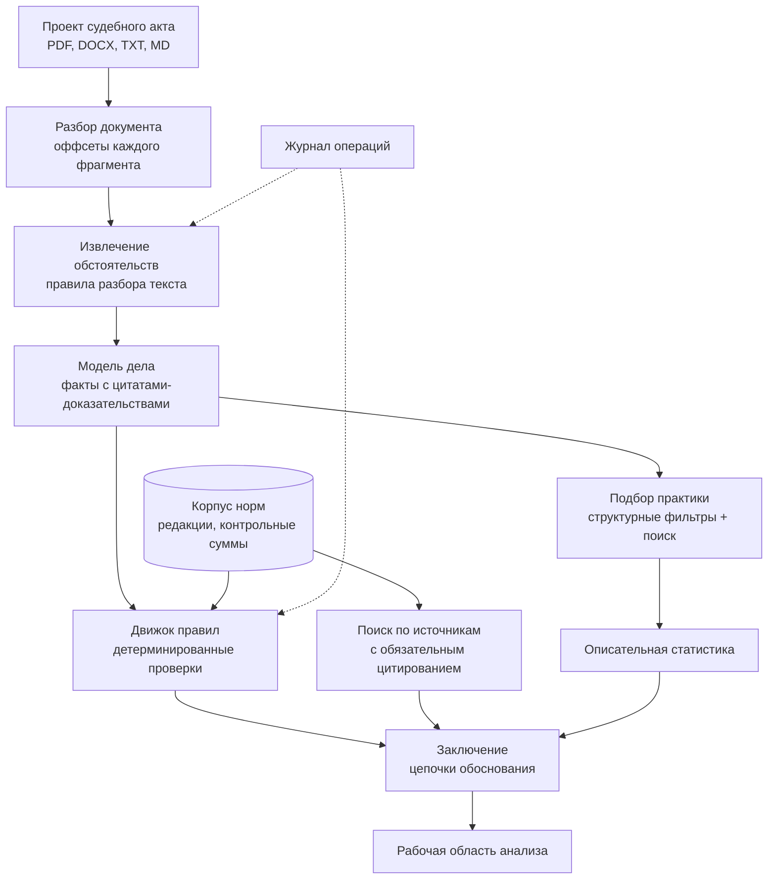

# Концепция проекта «Второе мнение»

Конкурсная работа на отборочный этап Всероссийского конкурса студенческих
проектов «Алгоритм правосудия. Второе мнение» (Положение утверждено
приказом Председателя Верховного Суда РФ от 31.07.2026 № 55-П).

Документ отвечает на требование п. 2.2 Положения: описание архитектуры
решения, используемых данных, алгоритмов и правовой методологии.

Состояние на 07.10.2026: работающий прототип, 957 автоматических проверок,
31 норма с редакциями, 8 детерминированных правил. Что сделано и что нет —
раздел «Честная карта покрытия».

## Содержание

- [Задача и подход](#задача-и-подход)
- [Правовая методология](#правовая-методология)
- [Архитектура решения](#архитектура-решения)
- [Используемые данные](#используемые-данные)
- [Алгоритмы](#алгоритмы)
- [Соответствие требованиям Положения](#соответствие-требованиям-положения)
- [Честная карта покрытия](#честная-карта-покрытия)
- [План до финала](#план-до-финала)

## Задача и подход

Судья готовит проект приговора. Система принимает этот проект и отвечает
на один вопрос: **не разошёлся ли он с законом и практикой** — и, если
разошёлся, показывает, где именно и на каком основании.

Ключевой выбор проекта: **проверяемость важнее полноты**. Система не
отвечает на вопрос «какое наказание правильное» — она отвечает «вот
проверки, которые я умею провести, вот их результат, вот источник
каждого». То, что проверить нельзя, называется прямо, а не сглаживается.

Отсюда главное свойство: **каждое утверждение раскрывается до источника**.

```text
вывод -> юридический факт -> цитата из документа с оффсетами
      -> правило -> редакция нормы на дату деяния -> официальный источник
```

Цепочка не декларация, а инвариант, закреплённый в коде и тестах: факт без
цитаты не может получить статус «подтверждён», правило без нормы-основания
не регистрируется, норма без сверки юристом остаётся черновиком.

## Правовая методология

### Норма применяется в редакции на момент совершения преступления

Требование п. 2.5.1.в. Реализовано как свойство хранилища, а не как
проверка на выходе: `get_norm(norm_id, applicable_at)` физически не умеет
вернуть «текущую» редакцию для исторического дела. Каждая редакция несёт
интервал действия, источник, дату выгрузки и контрольную сумму текста.

Дата юридически значимого события извлекается из документа; если её нет,
система говорит об этом, а не подставляет сегодняшнюю.

Свежая редакция никогда не подставляется молча. Плановая сверка с
официальным источником обнаруживает изменение нормы и **зовёт человека**,
а не обновляет корпус сама.

### Правило — это код с нормой-основанием, а не эвристика

Каждое правило — версионируемый класс, который обязан перечислить
использованные факты и применённые нормы с номером редакции, привести
численный расчёт и объяснение. Правило, не сумевшее этого, возвращает
«данных недостаточно», а не догадку.

Восемь правил закрывают пределы назначения наказания: санкция статьи,
неоконченное преступление (ст. 66), особый порядок (ч. 5 ст. 62,
ч. 7 ст. 316 УПК), смягчающие пп. «и»/«к» (ч. 1 ст. 62), комбинированный
предел, условное осуждение (ст. 73), несовершеннолетние (ст. 420 УПК),
полнота данных о наказании.

Два правила были **удалены** после юридической сверки: они кодировали
неверно понятые нормы. Это записано в истории проекта и считается
нормальной частью методологии, а не провалом.

### Основания освобождения от ответственности и наказания

Требование п. 2.5 Положения. Охватывается весь раздел IV УК РФ (ст. 75–86):
главы 11 и 12 — освобождение от уголовной ответственности и от наказания,
глава 13 — амнистия, помилование, судимость.

**Состояние на 20.09.2026 — первый черновик, не активирован.** Написано
правило `ReleaseFromResponsibilityRule` (глава 11: ст. 75 деятельное
раскаяние, ст. 76 примирение с потерпевшим, ст. 76² судебный штраф) и
покрыто девятью тестами. Нормы, на которые оно ссылается, получены
автоматически из ИПС «Законодательство России» (`pravo.gov.ru`, документ
102041891, редакция 365) — дословно, без пересказа, — и записаны со
статусом `draft`.

Правило **не зарегистрировано в активном движке**. Инвариант И-10
запрещает правило без верифицированной юристом нормы-основания; текст,
который система сама скачала, таким основанием не является, сколько бы
тестов ни было написано. Активация — одна строка в списке правил после
того, как юрист подтвердит текст норм; до этого правило физически не
может попасть в отчёт судьи, что бы ни было в коде.

Два ограничения заложены в устройство, а не в оговорку:

1. Результат — **только предупреждение или «данных недостаточно»**.
   Формулировка «проверьте, не применима ли ст. 76.2», а не «прекратите
   дело». Решение о прекращении — исключительно судейское (п. 2.5.3).
   Отдельно: молчание извлекателя о возмещении ущерба не превращается в
   «вред не заглажен» — это тоже «данных недостаточно», а не отрицание.
2. Правило **знает свою процессуальную стадию**. Условно-досрочное
   освобождение и замена неотбытой части относятся к исполнению приговора;
   указание на них в проекте приговора было бы ошибкой, а не полнотой.

**Ст. 78 (сроки давности)** доработана 07.10.2026 так же, как и глава 11: написан расчёт,
не подключённый к движку. Дата приговора читается из шапки документа (на пяти из шести
реальных приговоров находится, у шестого суд обезличил дату, и она не выдумывается),
категория преступления берётся по максимуму лишения свободы, срок в два, шесть, десять
или пятнадцать лет считается от даты деяния до даты приговора с запасом на вступление в
силу. Результат — «проверьте, не применима ли ст. 78», а не «освободите»; приостановление
срока, изменение категории судом и пожизненное лишение свободы не проверяются и названы в
выводе. Подключение ждёт юриста: текст ст. 78 в корпусе — черновик, ст. 15 в корпусе нет.

**Чего в черновике пока нет** — не потому что забыто, а потому что
честный черновик короче неполного: ст. 76¹ (экономические преступления,
вне статей, которые понимает движок) и вся глава 12 (ст. 79–83 —
условно-досрочное освобождение, замена наказания, давность приговора: это стадия
исполнения, а не постановления приговора, и требует отдельного набора фактов).

### Статистика описательна и не является основанием

Сопоставимая практика и распределение сроков — справочный материал.
Система показывает, где назначенный срок стоит в распределении, и
сопровождает это оговоркой. Формулировки проверяются автоматически: слова
«следует», «рекомендуется», «завышен», «занижен» в описательных выводах
недопустимы и ломают сборку.

Сходство между делами не выражается процентом: процент создаёт видимость
измеренной близости там, где её нет.

### Чего система не делает никогда

- не выдумывает источники: пустой результат поиска остаётся пустым;
- не выдаёт вывод языковой модели за юридическое основание;
- не прячет неопределённость;
- не добавляет правило без верифицированной нормы-основания;
- не отправляет документы во внешний контур без явного решения оператора.

## Архитектура решения

Модульный монолит на Python 3.11+ (FastAPI, Pydantic v2). Выбор против
микросервисов сделан осознанно и зафиксирован решением: на этом объёме
деление на службы добавляет отказы, а не надёжность.



Слои разделены интерфейсами и не ходят друг к другу в обход контрактов:

| Слой | Ответственность | Что запрещено |
|---|---|---|
| Представление | HTTP, интерфейс судьи, консольные команды | бизнес-логика в обработчиках |
| Оркестрация | последовательность этапов разбора | собственные юридические утверждения |
| Домен | модели фактов, норм, оценок | обращения к сети и файлам |
| Приложение | извлечение, правила, источники, практика | прямые вызовы модели вне интерфейса провайдера |
| Инфраструктура | хранилища, провайдеры моделей, журнал | юридическая семантика |

Языковая модель подключена **за интерфейсом провайдера**: бизнес-логика
зависит от контракта, а не от поставщика. По умолчанию система работает
офлайн на детерминированном заменителе — внешние обращения выключены,
пока оператор не включит их сознательно.

Хранилище документов и отчётов тоже за интерфейсом: файловый носитель для
демонстрации, PostgreSQL с pgvector для эксплуатации. Переключение — одной
переменной окружения, без правки кода.

## Используемые данные

### Нормативный корпус

31 норма, 38 редакций. Каждая редакция хранит: текст, интервал действия,
источник и его реквизиты, дату выгрузки, SHA-256 текста и статус сверки.

**Статус сверки ставит юрист, а не машина.** Машинно полученный текст
остаётся черновиком. Сейчас 32 редакции сверены юристом по
КонсультантПлюс (03.09.2026); 6 остаются черновиками: 2 — синтетическая
демонстрационная норма, явно помеченная, и 4 — первый черновик главы 11 УК РФ,
полученный из ИПС и юристом не сверенный.

Корпус **опечатан манифестом**: контрольные суммы всех редакций собраны в
отдельный файл, и подмена текста или санкции обнаруживается отдельной
командой. Правка фикстуры без переопечатывания не проходит в основную
ветку — это автоматическая проверка, а не договорённость.

Источник редакций — ИПС «Законодательство России» (`pravo.gov.ru`):
государственный, не требует токена и подписки, отдаёт консолидированные
редакции с датами. Выбор зафиксирован отдельным решением; открытые
корпуса и коммерческие системы рассмотрены и отклонены с указанием
причин.

### Судебная практика

31 дело: 26 синтетических (явно помечены признаком синтетичности, за
реальную практику не выдаются) и **5 реальных приговоров**, добавленных
20.09.2026 — по одному на каждую статью, которую уже понимает движок
правил (ст. 111, 158, 159, 161, 228), с разным исходом: реальный и
условный срок, штраф, рецидив, особый порядок, групповое деяние.

Источник — СудАкт.ру, приговоры судов общей юрисдикции, опубликованные в
порядке 262-ФЗ «Об обеспечении доступа к информации о деятельности
судов»: участники уже обезличены самим судом при публикации (ФИО
заменены на «ФИО1», «ФИО2»). Дополнительное обезличивание наших фактов
здесь не требуется — текст пришёл обезличенным.

**Реальное дело обязано быть прослеживаемо, а не просто помечено.**
Модель `ComparableCase` не позволяет создать запись `synthetic=False` без
`source_url` — тот же инвариант «утверждение раскрывается до источника»,
применённый к практике, а не только к нормам. Утверждение «это реальная
практика» стоит ровно столько, сколько стоит ссылка, которая его
подтверждает.

Пять дел — сознательный старт, а не итоговый размер базы: расширение до
десятков требует либо продолжения ручного отбора, либо отдельного решения
об автоматизированном сборе (парсинг, фильтрация, правовая экспертиза
качества источника).

### Персональные данные

Обезличивание делается **на выходе, а не при загрузке**: хранится
дословный текст, иначе невозможно выполнить инвариант о цитате.
Маскирование перед передачей внешней модели включено по умолчанию и
**сохраняет длину фрагментов** — иначе оффсеты сдвигаются и цитаты
отсеиваются как выдуманные.

Полнота обезличивания не гарантируется, и это сказано в интерфейсе, в
документации и в коде. Реализовано право на забвение: удаление документа
каскадом удаляет отчёты по нему.

### Безопасность

Проверка по чеклисту безопасности по слоям (06.10.2026) нашла 23 пункта. 19 исправлены в
коде, три закрыты частично или описанием порядка (сброс пароля без ссылки, резервные копии,
кэш префиксов vLLM), один оставлен сознательно: открытый режим без входа
для демонстрации на loopback. Всё это названо в `docs/SECURITY.md`.

- **Чужие дела.** В режиме личных учётных записей владелец проверяется в каждом маршруте:
  судья A не читает, не меняет и не удаляет документы и заключения судьи B, а чужой объект
  отвечает так же, как несуществующий.
- **Вход.** Один и тот же ответ для неверного пароля, неизвестного адреса и заблокированной
  записи; ограничение частоты; блокировка после неудач; пароли хранятся как bcrypt-хэши,
  учётные записи и пароли заводит и меняет только оператор командами (`create-user`, `update-user`, `delete-user`, `reset-password`), через интерфейс и HTTP-API это невозможно; правку корпуса норм делает только администратор. Долгоживущий refresh-токен
  лежит в `HttpOnly` cookie с `SameSite=Strict`, а не в хранилище браузера.
- **Нагрузка и ввод.** Лимиты на запуск анализа и число одновременных анализов, предел длины
  ответа модели, ограничение тела запроса до разбора, проверка типа файла по содержимому.
- **Транспорт и ошибки.** Строгий CSP без встроенных скриптов и стилей, заголовки
  безопасности, единый ответ на непредвиденную ошибку без внутренностей, в журнал и логи
  тексты документов не попадают.
- **Развёртывание.** Контейнер не от root, приложение подключается к базе ролью без прав
  суперпользователя, версии зависимостей закреплены с хэшами, в CI сканируются секреты и
  зависимости, веса модели грузятся только в формате safetensors без исполнения кода.
- **Модель.** Текст документа передаётся как недоверенные данные, цитата каждого факта
  проверяется по тексту, факт модели не участвует в проверках, пока судья его не подтвердил.

Что остаётся: access-токен на 30 минут лежит в `sessionStorage`; сброса пароля по ссылке нет
(нужен почтовый канал, а в закрытом контуре его нет); второго фактора входа нет; документы хранятся без шифрования на
уровне приложения, порядок шифрованных резервных копий описан в `docs/PRIVACY.md`.

## Алгоритмы

### Извлечение обстоятельств

Сейчас разбор целиком детерминирован: обстоятельства извлекаются
правилами разбора текста, выводы — правилами движка, поиск — лексический.
Обученных моделей в рабочем пути нет ни одной, и это сознательный выбор
первого этапа: результат воспроизводим и раскрывается до цитаты.

#### Два независимых пути

**Паттерновый извлекатель** (детерминированный): квалификация вида
«ч. 2 ст. 158 УК РФ», возраст, маркеры смягчающих и отягчающих, вид и
размер наказания, особый порядок, стадия преступления, дата деяния.
19 типов обстоятельств. Каждый результат несёт цитату с оффсетами
совпадения.

**Найдено на реальном приговоре (СудАкт.ру) 29.09.2026 и почищено в тот
же день.** Квалификация, дата совершения и процедурные факты (особый
порядок, присяжные, состав группы, признание вины, явка с повинной,
возмещение ущерба) искались по всему документу — а вводная часть
приговора почти всегда называет судимости подсудимого, включая статью,
дату и обстоятельства ПРЕЖНЕГО дела. На конкретном документе это дало бы
не просто лишний факт, а неверную «первичную квалификацию» (движок
правил проверял бы предел санкции по чужой статье) или неверную
юридически значимую дату (выбор редакции нормы шёл бы по дате чужого
преступления). Исправлено ограничением поиска этих фактов
текстом после «У С Т А Н О В И Л» — обязательного заголовка описательной
части приговора, отделяющего вводную часть от существа дела. Личные
характеристики подсудимого (возраст, факт судимости, состояние здоровья)
таким ограничением не связаны: они верны для подсудимого целиком, а не
только применительно к текущему делу.

**Извлечение языковой моделью** — путь реализован, но **сейчас не
задействован**: провайдер по умолчанию детерминированный, и в измерениях
ниже участия модели нет. Готово следующее: структурированный вывод по
схеме с повторной попыткой при негодном ответе, валидация, передача
текста документа **как данных** между явными метками с отделением
системных инструкций (защита от инъекций проверяется тестом),
маскирование персональных данных перед отправкой с сохранением длины
фрагментов.

Умолчаний на конкретного поставщика в коде нет намеренно: адрес и имя
модели называет тот, кто включает внешний контур, иначе забытая настройка
увела бы документы к провайдеру, которого никто не выбирал. Подключение
отечественной модели — работа к финалу.

Результаты объединяются; **цитата каждого факта проверяется по исходному
тексту**, и факт, чью цитату в документе не нашли, отбрасывается. Это
делает выдумывание фактов моделью технически безрезультатным.

Качество измеряется: macro-F1 извлечения 1.000 на золотом наборе из 15
синтетических образцов, доля утверждений без
доказательства — 0.

### Выбор редакции нормы

Бинарный поиск по интервалам действия с проверкой границ. Точность выбора
редакции на дату — 1.0 на контрольном наборе, включая краевые случаи
(день вступления редакции в силу, день окончания её действия).

### Поиск по источникам

Лексический поиск с учётом словоформ и взвешиванием по редкости термина
(IDF) по корпусу редакций. Каждый результат — фрагмент реально хранящейся
редакции с реквизитами; пустой результат не подменяется генерацией.
Recall@5 = 1.0 на контрольном наборе из 18 запросов.

Гибридный режим (лексика + векторная близость на pgvector) реализован и
включается переключателем. Векторная часть на отборочном этапе не
является основной: на корпусе такого размера лексический поиск точнее, и
это измерено, а не предположено.

### Подбор сопоставимых дел

Структурные фильтры по статье, части, стадии, рецидиву и процедуре, затем
ранжирование. Отбор объясняется: видно, по каким признакам дело признано
сопоставимым.

### Описательная статистика

Медиана, квартили, распределение видов наказания, доля условного
осуждения, положение назначенного срока в выборке. Выход срока за весь
наблюдаемый диапазон попадает в раздел проблемных мест; попадание в
верхнюю четверть — нет, это обычное дело.

## Соответствие требованиям Положения

| Пункт | Требование | Состояние |
|---|---|---|
| 2.5.1.а | Загрузка акта в машиночитаемом виде | ✅ PDF, DOCX, TXT, Markdown; распознавание сканов как запасной путь |
| 2.5.1.б | Извлечение ключевых параметров | ✅ 19 типов обстоятельств, каждое с цитатой |
| 2.5.1.в | Проверка по санкции, Общей части, редакции на момент деяния, Пленуму, Президиуму | ⚠️ санкция, Общая часть, редакции, Пленум — есть; Президиум — нет |
| 2.5.1.г | Поиск аналогичных приговоров, статистические отклонения | ⚠️ логика есть; 5 реальных приговоров с прослеживаемым источником + 26 синтетических |
| 2.5.1.д | Заключение: аннотация, соответствие закону и практике, проблемные места, статсправка | ⚠️ всё есть, кроме Обзоров судебной практики |
| 2.5 | Основания освобождения по разделу IV УК РФ | ⚠️ первый черновик (гл. 11, ст. 75/76/76²) написан и протестирован, не активирован — ждёт юридической сверки |
| 2.5.2.а | «Личный кабинет» и «Рабочая область анализа» | ✅ |
| 2.5.2.б | Приоритет отечественного и открытого ПО | ⚠️ стек открытый; Концепция ВС РФ требует не просто приоритета, а закрытого контура — решение 29.09.2026: самостоятельно развёрнутая модель через vLLM (см. «Честная карта покрытия» ниже) |
| 2.5.2.в | Русский язык интерфейса и документации | ✅ |
| 2.5.3 | Не заменяет судью | ✅ инвариант, проверяется тестами |

## Честная карта покрытия

Раздел открыт намеренно: неназванная слабость опаснее названной, и жюри
всё равно её найдёт.

**Данные.** Практика — 5 реальных приговоров с прослеживаемым источником
плюс 26 синтетических; для полноценного статистического сопоставления
этого мало, реальных дел на каждую статью ровно по одному. 18 норм из 31
имеют одну редакцию на длинный интервал — история изменений не
зафиксирована, и обещание «редакция на дату» держится настолько,
насколько полны данные. Точки отсчёта для сверки с официальным
источником проставлены только у четырёх норм главы 11 (черновик); у остальных
27 их нет, поэтому плановая проверка обновлений по ним отвечает «проверить не
удалось».

**Право.** Раздел IV УК РФ — первый черновик (глава 11, три статьи из
двенадцати), написан, но не активирован: ждёт юридической сверки, без
которой инвариант И-10 не позволяет включить правило в движок. Так же устроены
ещё два черновика: расчёт допустимых вариантов при совокупности (ст. 69, 70;
проверен на четырёх реальных приговорах: в одном итог сходится с расчётом, в одном
наказание штраф, предел которого в корпусе не хранится, а в двух присоединено
дополнительное наказание, и расчёт честно отвечает «данных недостаточно») и расчёт
сроков давности (ст. 78). Нет решений Президиума и Обзоров судебной практики. Отдельной проверки по
ст. 64 нет — она упоминается как возможное основание внутри проверки пределов.

**Аудит данных 06–07.10.2026.** Корпус и извлечение сверены с первоисточниками, и
сверка нашла ошибки, которые исправлены или названы. Девять из двенадцати проверенных
статей УК РФ менялись, а в корпусе по ним одна редакция: черновик истории по ИПС
передан юристу на сверку. У первых редакций стояла дата 1 июля 1996 года,
а УК РФ введён в действие с 1 января 1997 года; у двух норм не было нижнего предела
лишения свободы, который есть в исходной редакции. Извлечение сверено с пятью реальными
приговорами: найдены и исправлены чтение статьи из судимости, ложный вид наказания,
срок за преступление вместо срока по совокупности и дата приказа вместо даты
деяния. Каждая находка закрыта тестом, а сверка не заменяет юриста: подтверждение
исправлений за ним.

**Машинное обучение.** Обученных моделей в рабочем пути **по
умолчанию** нет ни одной — извлечение остаётся детерминированным
сознательно, после измерения, а не за неимением адаптера. Модель
подключена и прогнана на живых документах (раздел «Алгоритмы» выше):
на измеренном железе она не улучшает извлечение и на два порядка
медленнее паттернов, к тому же дважды из пятнадцати не выдала валидный
JSON. Это не значит «модель не нужна» — значит «нужны ещё измерения»:
модель большего размера, принудительная JSON-схема, реальные документы
вместо синтетических. Векторные представления считает хэш-функция по
символьным n-граммам, а не обученный энкодер; лексический поиск —
классическое взвешивание по редкости термина.

Мы называем это прямо, потому что критерий технической реализации
упоминает алгоритмы машинного обучения. Позиция проекта: юридический
вывод обязан быть воспроизводимым и раскрываемым до нормы, поэтому
обучаемая модель не допускается туда, где делается вывод. Её место —
извлечение обстоятельств из текста, где результат всё равно проверяется
поиском цитаты в документе.

Адаптеры GigaChat и Yandex AI Studio написаны и покрыты тестами;
включаются настройкой без правки кода. Прогон на живых документах
проведён 20.09.2026 — не на облачном поставщике (ключей на момент замера
не было), а на локальной модели того же класса: Qwen2.5-7B-Instruct
через Ollama на графическом процессоре Apple M4 (29/29 слоёв на GPU,
Metal). Интерфейс провайдера один и тот же, поэтому результат
переносится на GigaChat и на любой другой OpenAI-совместимый контур —
меняется адрес, а не код.

**Решение по закрытому контуру принято 29.09.2026** (`docs/TZ.md`,
раздел 2.10): сверка первоисточника (28.09.2026) показала, что Концепция
ВС РФ запрещает не «облачных провайдеров без приоритета отечественных»
— она запрещает публичные ИИ-сервисы и передачу данных в публичные
облака целиком, без исключения на осознанное решение оператора. И
GigaChat, и Yandex AI Studio в дефолтной конфигурации — публичные облачные
API, а не развёрнутый в своём контуре экземпляр. Путь, который этому не
противоречит: модель, развёрнутая через vLLM на той же машине/периметре,
что и сама система, — тот же `OpenAICompatibleProvider`, что уже измерен
на Ollama выше, другой адрес и порт (пример — `.env.example`).

Контракт сверен построчно с документацией vLLM 29.09.2026: маршрут
(`/v1/chat/completions`), тело запроса (`model`/`messages`/`temperature`)
и путь к тексту в ответе (`choices[0].message.content`) совпадают с тем,
что уже отправляет и читает `OpenAICompatibleProvider`. Подготовка к развёртыванию готова (`docs/DEPLOYMENT_VLLM.md`: образ с закреплённой версией,
проверка сервера и контракта, закрытый контур), но живого прогона
именно с vLLM нет — и не может быть на этой машине разработки: пакет
`vllm` на PyPI собирается только под Linux, колеса под macOS не
существует, независимо от GPU. Единственная честная проверка вживую —
на Linux/GPU-стенде, том же классе машины, на который систему в итоге
разворачивают. Судьба GigaChat/Yandex как облачных опций (оставить с
предупреждением или убрать) отдельным решением не закрыта.

**Результат честный: модель ничего не добавляет.** На золотом наборе (15
документов) добавление модели поверх паттернового извлекателя —
`evaluation/llm_extraction_probe.py`, тот же класс `LLMFactExtractor`,
что работает в проде, а не отдельный тестовый путь. Два прогона на
Qwen2.5-7B через Ollama:

| Прогон | Промпт | Только паттерны | Паттерны + модель | Задержка на документ, среднее / максимум |
|---|---|---|---|---|
| 20.09.2026 | v1 | 0.982 | 0.975 | 45 с / 116 с |
| 06.10.2026 | v1 | 1.000 | 1.000 | 30 с / 56 с |
| 06.10.2026 | v2 (19 типов) | 1.000 | 1.000 | 36 с / 62 с |

Все значения — macro-F1; у паттернов задержка доли секунды.

Модель не нашла ни одного типа обстоятельства, упущенного паттернами; в прогоне
06.10 на промпте v1 она приняла по одному факту в двух документах, на v2 — ни
одного; оценка не менялась. Паттерны на этом типе документов почти
исчерпывающие, и добавлять модели нечего. Золотой набор состоит из тех же
синтетических образцов, на которых велась разработка паттернов, поэтому «1.000»
не оценка обобщения на реальные тексты.

В прогоне 20.09 модель ухудшила результат на двух документах из пятнадцати,
не выдумав текста (цитаты настоящие), а неверно истолковав его: на фразе
«ранее не судимого» создала факт `prior_convictions` с пустым значением.
**Проверка цитаты защищает от выдумывания текста, но не от неверного
прочтения существующего.** Это предел метода, и жюри стоит показать его
прямо. После 05.10.2026 значение факта модели проходит ту же проверку формы,
что и введённое человеком, а скалярные факты (возраст, особый порядок, дата
деяния, наказание и другие) модель только дополняет, не перекрывая найденное
паттерном. В прогоне 06.10 ухудшений нет; причина исчезновения прежних двух
не разбиралась.

Живой прогон 05.10.2026 вскрыл два дефекта связки, не качества модели.
Модель перечисляла все типы фактов, для ненайденных ставя пустую цитату, и
пять таких записей делали невалидным весь ответ с шестью верными фактами;
теперь такие записи отбрасываются по отдельности. А дата деяния, которую
модель вернула словами («15 марта 2025 года»), перекрывала дату паттерна,
и нормы применялись на сегодняшний день; теперь значение другой формы
отбрасывается.

Первый замер на промпте v2 (06.10.2026) дал 0.950: модель возвращала признаки
со значением `false` и нерелевантными цитатами (например «special_procedure:
false» с цитатой «На основании изложенного суд»). Это вскрыло третий дефект:
сборщик дела игнорировал значение факта и добавлял смягчающее или отягчающее
обстоятельство даже при `false`. Теперь при `false` обстоятельство не
добавляется, факты модели со значением `false` не принимаются, а промпт v2
просит их не включать. Промпт v2 перечисляет все 19 типов обстоятельств и формат
значения для каждого (v1 называл 16 типов).

Дальнейшие замеры на v2 дали ещё два случая. Модель добавляла `offense_stage:
completed`: верно по смыслу, но «оконченное» в системе состояние по умолчанию, и
явный факт лишь шумит; теперь он не принимается. И она утверждала
`offense_stage: attempt` с цитатой «совершила преступление 19 октября 2025
года», где о покушении ничего нет: цитата верна по тексту, но к факту не
относится, а стадия «покушение» меняет проверку предела. Теперь цитата стадии
обязана содержать слово стадии («покуш», «приготов»). Итоговый замер на 15
образцах: паттерны 1.000, паттерны + модель 1.000, принятых фактов модели 0.

Задержка 45 секунд на документ неприемлема для интерфейса, где судья
ждёт ответа немедленно. Три оговорки к этому числу: измерение сделано на
интегрированном GPU ноутбучного класса, а не на выделенной видеокарте —
на карте уровня RTX 4090 или на серверном GPU то же извлечение по
опубликованным ориентирам производительности vLLM для моделей такого
размера ожидаемо занимает секунды, а не десятки секунд, но эту цифру мы
не измерили и не выдаём за факт; запрос не использует потоковую выдачу
и ограничения на объём вывода, что дополнительно замедляет ответ;
структурированный вывод (`response_format`/grammar-ограничение) не был
включён — модель писала JSON по инструкции в промпте, а не по
принудительной схеме, что и объясняет часть сбоев формата.

**Вывод для отборочного этапа: извлечение остаётся в режиме по умолчанию
— детерминированные паттерны, модель выключена.** Не потому, что
адаптеры не работают, а потому, что на этой задаче и на измеренном
железе модель не улучшает результат и на два порядка медленнее. Дальнейшая
работа — не «подключить модель», а три отдельные проверки: даёт ли
выигрыш модель большего размера, помогает ли принудительная JSON-схема
вместо промпт-инструкции, и меняется ли картина на реальных, а не
синтетических документах, где регулярные выражения справляются хуже.
Каждая — с числом, а не с намерением.

## План до финала

| Очередь | Работы | Почему в этом порядке |
|---|---|---|
| 1 | Раздел IV УК РФ: корпус, обстоятельства, правила | Прямое требование п. 2.5, крупнейший правовой пробел |
| 2 | Редакционная история 18 норм и точки отсчёта | «Глубина проработки нормативной базы» держится на данных |
| 3 | Подключить совокупность (ст. 69, 70) и давность (ст. 78) после сверки юристом; Президиум, Обзоры | Частые практические случаи и прямые требования п. 2.5.1; расчёты написаны и проверены, ждут юриста |
| 4 | Расширить базу реальных приговоров сверх пяти стартовых | Первый шаг закрыт 20.09.2026 вручную; дальнейший рост — тем же способом либо решением об автоматизации |
| 5 | Прогнать `openai_compatible` вживую против настоящего vLLM на Linux/GPU-стенде | Контракт сверен с документацией vLLM 29.09.2026 (расхождений нет), но `vllm` на PyPI не собирается под macOS — живой прогон физически невозможен на машине разработки, нужен Linux |

Порядок задан приоритетами проекта: юридическая корректность ->
проверяемость -> воспроизводимость -> надёжность -> удобство -> скорость ->
сложность машинного обучения. Он не менялся с начала работы и не будет
изменён ради баллов: система, показывающая красивую метрику на неверной
норме, вредна.

---

Подробности: [ARCHITECTURE.md](ARCHITECTURE.md) — устройство,
[TZ.md](TZ.md) — требования с номерами и статусами,
[RULE_ENGINE.md](RULE_ENGINE.md) — реестр правил,
[DATA_SOURCES.md](DATA_SOURCES.md) — источники,
[EVALUATION.md](EVALUATION.md) — методика измерений,
[LEGAL_SAFETY_PRINCIPLES.md](LEGAL_SAFETY_PRINCIPLES.md) — принципы
безопасного обращения с правом.
